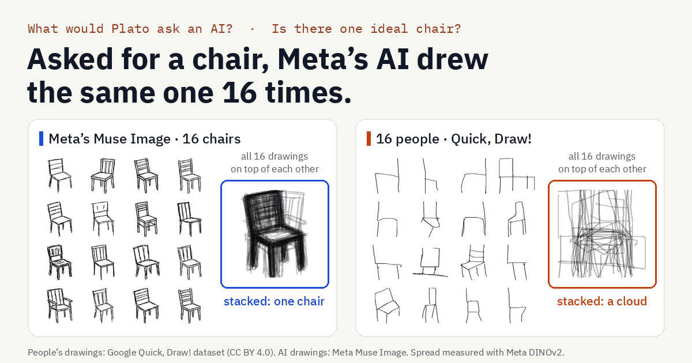

# Plato's Chair: what would Plato ask an AI?

**Asked for a chair, Meta's image model drew the same one 16 times. People drew 16 different ones, mostly of the same plain chair.**



Plato held that each kind of thing has one ideal Form, and every real one is a copy. We put his questions to Meta's AI and to people. The first one: *is there one ideal chair?* We asked Meta's image model, Muse Image, for 16 quick doodles of a chair and of 34 other things, took 200 people's 20-second drawings of the same words from Google's Quick, Draw!, and measured how varied each set is with Meta's DINOv2 vision model.

The series follows the life of a chair, as an analogy: children's drawings move toward the adult chair from age 2 to 10, a small model trained on people's chairs grows from scribbles to adult-like chairs, and damage to an image model's language part makes its chair wander off into other things, much as drawings lose their distinctive features in some brain diseases (Bozeat et al. 2003; published neurology, not our data).

- **See it:** run the site (below) and open `/` (a short opening animation, then draw a chair blind and see the reveal), `/plato` (the whole experiment), `/draw` (draw a chair in 20 seconds, then see what Meta's AI drew), the other experiments under `/plato/…` (table below) and `/socrates` (ask an AI playing Socrates).
- **Read it:** [docs/plato.md](docs/plato.md) (35 things, a second image model, prompting for variety), [docs/plato_glimmer.md](docs/plato_glimmer.md) (inside Muse Glimmer), [docs/plato_languages.md](docs/plato_languages.md) (six prompt languages), and one write-up per experiment: [forms](docs/plato_forms.md), [cave](docs/plato_cave.md), [cratylus](docs/plato_cratylus.md), [bird](docs/plato_bird.md), [damage](docs/plato_damage.md), [lifespan](docs/plato_lifespan.md).

## What we found

| | Result |
|---|---|
| **Almost everything** | Muse Image drew **34 of 35** things more alike than people did. Typically its drawings are about half as varied as people's (median ratio **0.49**). Only books came out as varied. |
| **"Any kind" changes nothing** | "A chair (any kind of chair)" gives the same slat-back chair again; across 35 things the ratio stays at 0.49. |
| **Naming the kinds works** | When Muse Spark lists 16 kinds and Muse Image draws one of each, the drawings are **1.30 times** as varied as people's. Muse knows the variety: its narrow chair is a default, and it varies when asked. |
| **People draw the plain chair too** | **83%** of people's recognizable drawings show the plain, ordinary kind (Muse Glimmer's labels, all 35 things), the same share as Muse Image's usual prompt. People's extra variety is mostly *how* they draw a thing, not *which* one. |
| **It's Muse, not all AI** | From the same prompt, Stable Diffusion XL's drawings vary about **2.4 times** as much as Muse Image's, more for 34 of 35 things. Much of that is drawing style (frames, shading, scenes), not different objects. |
| **Inside the model** | Shown both sets of doodles, Muse Glimmer files Muse Image's doodles of a thing in essentially one place by its last layers (average spread 0.09), while people's stay spread out (0.54); people's are more spread out for 35 of 35 things. Things people draw in more ways are harder for it to name (rank correlation −0.50). |

Caveats, in short: one prompt style, 12–16 AI pictures per thing, and a style gap (clean marker sketches against quick mouse drawings), which is why the ranking across things matters more than the exact ratio. The kind labels are a model's reading, checked on pictures whose kind we knew. Everything is in [docs/plato.md](docs/plato.md).

### What Plato said

Plato's own example was a bed. In *Republic* X (597b), Socrates describes three beds: one "existing in nature, which is made by God", one that is "the work of the carpenter", and "the work of the painter". The painter copies how a bed looks from one place: "you may look at a bed from different points of view, obliquely or directly or from any other point of view, and the bed will appear different, but there is no difference in reality" (598a). An image model is Plato's painter. Asked for a chair, Muse Image paints one appearance, from the same three-quarter angle, 16 times.

Plato was also the first AI skeptic. In the *Phaedrus* (275d), Socrates says of written words: "You would imagine that they had intelligence, but if you want to know anything and put a question to one of them, the speaker always gives one unvarying answer."

Quotations are from Benjamin Jowett's public-domain translation, as published by Project Gutenberg ([Republic](https://www.gutenberg.org/ebooks/1497), [Phaedrus](https://www.gutenberg.org/ebooks/1636)); the numbers are Stephanus pages.

### The Plato series

Each experiment puts one of Plato's questions to an AI and to people. The site shows a card for each page once it is served (`metalesionlab/web/site.py`).

All seven are done; each write-up gives its pre-registered predictions, including the ones that failed.

| Plato's question | Where he asks it | Page | What we found |
|---|---|---|---|
| Is there one ideal chair? | *Republic* X, the Forms | `/plato` | Muse Image drew 34 of 35 things more alike than people (median ratio 0.49). It is a default: named kinds lift it to 1.30 times people's, and Stable Diffusion XL varies about 2.4 times as much. ([doc](docs/plato.md)) |
| Is there one ideal clock, bed or table? | *Republic* X | `/plato/forms` | With no time asked, Muse Image drew the advert's 10:10 on 13 of 16 clocks by eye (8 by the automatic reader); people on 2%. Asked for a time, it never drew 10:10 (0 of 72), against our prediction. Its table and bed are about as uniform as its chair (0.39 and 0.47 of people's spread). ([doc](docs/plato_forms.md)) |
| Can you know a thing from its shadow? | *Republic* VII, the Cave | `/plato/cave` | Muse Glimmer named 67% of cast shadows (outlines 86%, silhouettes 90%); its most common wrong answer was "Shadow". It finds hard the silhouettes people find hard (rho 0.32), but names more of them. The predicted silhouette delay inside the model did not appear. ([doc](docs/plato_cave.md)) |
| Do names fit things by nature? | *Cratylus* (bouba and kiki) | `/plato/cratylus` | Muse Image drew every "kiki" spiky and every "bouba" round, but new words with kiki's sounds ("keti", "tepi") came out round: it knows the famous answer, not the rule. Muse Spark follows the consonants as people do; Glimmer barely separates bouba from kiki. ([doc](docs/plato_cratylus.md)) |
| Is there one best example of a kind? | The Forms, with Wittgenstein and Rosch | `/plato/bird` | Muse Spark's favourite answer takes 90% of its answers across 117 categories, people's 48% ("name a bird": sparrow 49 of 50; 20 people gave 11 birds). Glimmer's own probabilities are as varied as people's. The predicted larger gap for abstract categories was absent. ([doc](docs/plato_bird.md)) |
| What happens to the Form when the mind is damaged? | Our own question | `/plato/damage` | Damage to Stable Diffusion XL's language part loses the asked kind faster than damage to its drawing part (−12 points [−20, −4]); the "how" half held for noise but reversed for neurons switched off, so the double dissociation is only partly supported. Chairs move away from the plain chair, never back to it. Damaged Glimmer's fallback to "a plain, ordinary" kind is generic: random neurons do the same. ([doc](docs/plato_damage.md)) |
| Is learning remembering the Forms? | *Meno* | `/plato/lifespan` | Children's drawings move toward adults' from age 2 to 10 (recognizable 39% → 72%). Stable Diffusion's training stages don't follow that path robustly; a small model trained on people's chairs does, and ends narrower than its data (spread 0.32 vs 0.37). ([doc](docs/plato_lifespan.md)) |

Also: **Draw a chair** (`/draw`, and the pad on the landing page). Visitors draw blind, in 20 seconds, like the Quick, Draw! players; then Muse Image's 16 chairs are revealed, and the drawing is measured the same way, on the server's CPU, against 200 people's. Drawings are processed in memory and never stored (an opt-in donation exists but is off by default: [docs/draw_donations.md](docs/draw_donations.md)). **Ask Socrates** (`/socrates`) is a Muse Spark agent that plays Socrates: it answers questions about the experiments from the real results, quotes Plato only from verified passages, and asks you one question back.

### How it works

| Step | Model or data |
|---|---|
| Draw 12–16 doodles of each of 35 things, one prompt each time | **Muse Image** (Meta) |
| 200 people's 20-second drawings of the same words | Google **Quick, Draw!** dataset (CC BY 4.0), streamed at run time, never committed |
| Turn each drawing into numbers; spread = mean pairwise cosine distance | **DINOv2** (Meta, open weights, run locally) |
| List kinds of each thing; label which kind each of 10,020 drawings shows | **Muse Spark**; **Muse Glimmer** (open weights, our GPU) |
| Look inside: spread after each of 52 layers, naming, damage | **Muse Glimmer** with the lesion engine and word lens |
| A second image model for comparison | Stable Diffusion XL (Stability AI, CreativeML OpenRAIL++-M), our GPU |

Code: `metalesionlab/plato.py`, `scripts/plato_*.py`, `metalesionlab/draw.py`; the `/plato` page reads statistics in `metalesionlab/web/data/plato.json` and small figures in `static/img/plato/` (written by `python scripts/plato_web_export.py`); figures with people's drawings keep their Quick, Draw! credit. `public_data/plato_*.json` hold derived statistics only. The full data folder (pictures, embeddings, raw results) lives outside the repository.

> Research and teaching use only. Nothing here diagnoses anyone or gives medical or treatment advice.

## Built during the Meta Global AI Developer Hackathon (Oct 26 – Nov 4, 2026)

Everything in this repository was written during the hackathon, starting at the kickoff on Oct 26, 2026. The commit history is the record.

| Date | Built |
|---|---|
| Oct 26 | Repo, data guard, Meta Model API client with spend ledger and budget cap |
| Oct 26 | Muse Glimmer in FP8 on a single L40S (32 GiB used). Picture naming with the reasoning channel skipped (it can leak into answers under heavy damage). Word lens (logit lens) that matches the model's own output at the last layer |
| Oct 26 | Naming-error classifier (English and Spanish), with WordNet plus a Muse Spark judge for meaning. It passed 34 unit tests that day and agreed with the expected code on 19 of 20 live cases; the one miss was a mistake in the expected answer. |
| Oct 26 | Web app (FastAPI, plain HTML and JS): landing page, Test Studio with live build progress, review and exports (cards PDF, norms CSV, ZIP), Scorer with voice recording per picture and reviewer override, Model Lab with the word-lens chart and published human profiles. Per-visitor limits on every paid call. A guided tour |
| Oct 26 | You vs. the AI (`/challenge`): name 10 pictures beside Muse Glimmer, then watch it lose a word |
| Oct 26 | Naming scored in French, Brazilian Portuguese, Hindi and Mandarin; language support measured in six languages ([docs/languages.md](docs/languages.md)) |
| Oct 26 | Naming Assessment: speech-onset latency (max error 5.6 ms on synthesized speech), first-complete-response coding, review and override, PDF report, tracking across sessions, parallel forms, bring-your-own test (ZIP or folder; a PowerPoint is converted on the command line), personal tests from a photo, and a public naming test with an opt-in reference range |
| Oct 26 | "What can I cut?": every Glimmer decoder layer skipped alone, a greedy removal path guarded by picture naming (English and Spanish) and perplexity on Muse Spark-written text, and real deletion of the chosen layers with measured size, memory and speed |
| Oct 26 | Plato's Chair: 35 things, Muse Image against Quick, Draw!, measured with DINOv2; six prompt languages; inside Muse Glimmer; the Stable Diffusion XL comparison; the `/plato` and `/lab/cut` pages, which replay shipped statistics with no API calls |
| Oct 26 | Bilingual lesion test: the same pictures and the same damage in English, Spanish, French and Portuguese |
| Oct 27 | Second language page (`/lab/bilingual`), Ask the Lab (`/ask`, a Muse Spark agent with read-only tools), and ten more languages measured for spoken scoring |
| Oct 27 | Plato's Chair, "Can you prompt it out of the Platonic chair?": "any kind", "an unusual kind" and named kinds; Muse Glimmer labels the kind of object in 10,020 drawings, with Muse Spark as a second opinion |
| Oct 27 | Pre-registered replication of the lesion results at n = 100 ([docs/replication.md](docs/replication.md)) |
| Oct 27 | Deploy kit: public-demo spend guard, site data bundle, container |
| Oct 27 | Draw a chair (`/draw`): a visitor's drawing measured with DINOv2 on the CPU, against Muse Image's chairs and 200 people's |
| Oct 27 | Ask Socrates (`/socrates`): Muse Spark plays Socrates over the Plato results |
| Oct 27 | Plato-first site: new landing page, one header and nav on every page (`web/site.py`), the product name in one place (`metalesionlab/brand.py`), share card, a shorter tour |
| Oct 27 | Plato's Bird (`/plato/bird`): "name a member of the category" for 117 categories, Muse Spark and Muse Glimmer against published norms, pre-registered |
| Oct 27 | Plato's Forms (`/plato/forms`): the Platonic clock (what time Muse Image, SDXL and people draw), and Plato's own bed and table, pre-registered |
| Oct 27 | Plato's Cave (`/plato/cave`, name the shadow) and Cratylus (`/plato/cratylus`, bouba and kiki), pre-registered, with a game on each page |
| Oct 27 | Draw a chair, round 2: the pad on the landing page, draw blind and then the reveal, photo upload, opt-in donation (off by default) |
| Oct 27 | The life of a chair (`/plato/lifespan`): children's drawings by age, Stable Diffusion's training stages, and a sketch model trained from scratch, pre-registered |
| Oct 27 | Plato's Chair, damaged (`/plato/damage`): reversible lesions in SDXL's text encoders and UNet, damaged Muse Glimmer reading doodles, clocks, and Janus-Pro, pre-registered |
| Oct 27 | Consistency pass: every number on the pages and in the docs checked against its source |
| Oct 27 | Two sites from one codebase (`MLL_SITE`): Plato's Chair, and its sister project Tippa Lingua on its own landing page, each with only its own pages, nav and paid routes, and a per-site data bundle. The opening animation on Plato's landing page (the cave, ending on the Form chair, now the logo) |

### Prior research context (not part of this submission)

The research question comes from the author's earlier work on simulating aphasia by lesioning a different vision-language model: Yang et al. (2026), "Lesioned multimodal language models reproduce aphasic picture-naming patterns", arXiv:2607.11621 (preprint). No code or participant data from that project; only its published group averages are shown (Table 1, C-STAR cohort, N = 278, one of three reference profiles in the Model Lab).

Built new during the hackathon:
- everything on Meta's models (Muse Glimmer, Muse Spark, Muse Image, SAM 3.1, Muse Voice Transcribe, DINOv2),
- Plato's Chair, the six other experiments of the series, Draw a chair and Ask Socrates,
- the test-building and scoring tools for people (Tippa Lingua),
- the word lens,
- the Ask the Lab agent,
- the language support, measured in 16 languages.

## Sister project: Tippa Lingua

Plato's Chair grew out of a lab for how people and AI find words. That lab is now its own site, **Tippa Lingua**: picture-naming tests for people and AI, and a lesion lab for Meta's open model. It runs from this same codebase with `MLL_SITE=lingua` (see [Web app](#web-app)), and each site links to the other at the foot of every page. Plato's Chair is the hackathon entry; Tippa Lingua is its sister project.

Its landing page puts the replication first: 16 languages measured (8 verified for spoken scoring), and the lesion results run again on 100 new pictures ([docs/replication.md](docs/replication.md)).

Four tools share one pipeline:

1. **Test Studio:** turns a word list into a picture test in your language.
   - **Muse Image** draws each item.
   - **SAM 3.1** checks that each picture shows exactly one clear object.
   - **Muse Spark** checks that the picture gets the intended name. (On the demo sets, **Muse Glimmer** also re-checked name agreement, offline on our GPU.)
   - You can export printable cards (PDF), a norms table (CSV) and the whole set (ZIP).

   Standard picture tests are copyrighted and mostly English, and building a checked set by hand takes weeks.
2. **Scorer:** the test is given by voice, and every response is transcribed and coded.
   - **Muse Voice Transcribe** transcribes the responses.
   - Naming errors are coded with the standard categories (semantic, formal, mixed, nonword, neologism, unrelated, description, no response), and **Muse Spark** acts as an independent second rater.
   - A person reviews the codes, then exports.

   Tasks: picture naming, picture description and category fluency.
3. **Naming Assessment:** a timed, computerized picture-naming test for clinicians and researchers, and a short public version anyone can take.
   - It measures accuracy (first complete response), error types and naming latency, and tracks change across sessions.
   - Tests can be our sets, a test you are licensed to use (a ZIP or folder of pictures with a CSV; a PowerPoint can be converted to that ZIP on the command line), or a personal test made from a photo of the person's own things (**Muse Spark**, **SAM 3.1**, **Muse Image**).

   It measures and reports, beside published reference values. It doesn't diagnose or predict; a qualified person interprets.
4. **Model Lab:** the same tests are given to **Muse Glimmer**, Meta's open-weight model.
   - You damage chosen parts of the model on purpose and watch aphasia-like errors appear.
   - A word lens shows the model's best guess at every layer.
   - **Ask the Lab** (`/ask`): a **Muse Spark** agent answers questions by querying the lab's results and comparing them with published profiles from people with aphasia, showing every step.
   - **What can I cut?** removes whole layers from the model, with your tests as the guardrail, and measures the real savings.

Layers are numbered 1–52 on the site and in this README; the result files and model code count from 0.

### How scoring works

The decision order follows the Philadelphia Naming Test scheme (Roach et al., 1996):

1. No response.
2. Correct, allowing articles, plurals, modifiers and accepted alternate names.
3. Description: three or more words that don't name the target.
4. For a real word, check meaning and sound:
   - meaning only → **semantic**
   - sound only → **formal**
   - both → **mixed**
   - neither → **unrelated**
5. For a non-word: sounds like the target → **nonword**; otherwise → **neologism**.

| Check | English | Spanish |
|---|---|---|
| Real word? | Common in wordfreq and listed in the CMU Pronouncing Dictionary | Common in wordfreq |
| Sound | The PNT rule: shared first or last sound, shared stressed vowel, or two shared sounds anywhere. Sounds come from the CMU dictionary, or from spelling rules for non-words. | Same rule, adapted because nouns end in a gender vowel: a shared final vowel doesn't count |
| Meaning | WordNet first. Muse Spark judges associations (milk for cat). | Muse Spark judges every pair |

See `metalesionlab/naming_errors.py`. French, Brazilian Portuguese, Hindi, Mandarin Chinese, German, Italian, Dutch, Japanese, Korean, Arabic, Turkish, Polish, Indonesian and Vietnamese have their own rules and measured results in [docs/languages.md](docs/languages.md).

**How we checked the coder.** `python scripts/verify_scorer.py rater` (about $0.12) codes 30 test responses (20 English, 10 Spanish) twice: once by these rules, and once by Muse Spark as an independent second rater working only from written category definitions. The 30 are constructed examples of each error type, not responses from real people. The two agreed on 93.3% (Cohen's kappa 0.92; English 90.0%, kappa 0.88; Spanish 100%). The two disagreements were *blorf* for ladder (rules: Neologism, Muse Spark: Nonword) and *sofa* for couch (rules: Semantic, Muse Spark: Correct; add *sofa* as an accepted name if your test allows it). Given the picture, Muse Spark also flags Visual errors the rules can't see (*grenade* for a pineapple drawing). This shows two independent coders agree on clear cases. It is not a comparison with trained human coders on real responses, which is still needed.

### Naming Assessment

`/assess` is for clinicians and researchers; `/take` is a 3-minute public version. Both use the same engine (`metalesionlab/assessment.py`, `metalesionlab/web/assess_routes.py`, `static/js/assess-engine.js`).

**For use by clinicians and researchers. Measurements only; no diagnosis or prognosis.** Every page and report says so. The public test reports numbers only, beside the range of adults who took the same test, and says it isn't a medical test.

#### What a session measures

- **Accuracy** on the first complete response, as in the PNT. "Dog, no, cat" is coded *dog*; fragments ("c-, cat"), comments ("let me think"), refusals followed by an answer and frames ("it's a", "es un") are set aside. A description stays whole.
- **Error types**, with the Scorer's coder and optionally Muse Spark as second rater. The reviewer can change any code or latency, or correct a transcript to re-code it; the reviewer's entries are final.
- **Naming latency**: picture onset to speech onset. Median and interquartile range for correct responses, latency per item, and items that reached the time limit (default 20 s, as in the PNT; reaching it counts as no response).
- A **reference panel** of published Philadelphia Naming Test group results (controls; pooled aphasia groups), labeled as group references on a different test, not norms for the person.
- Exports: a one-page PDF report with an item appendix, and an item-level CSV.

#### How latency is measured

The browser captures the microphone continuously (AudioWorklet) and places each picture's onset on the audio clock, at the frame the picture is painted. Each clip starts 300 ms before the picture and is sent as 16 kHz WAV with the onset's position. On the server, `audio.detect_speech` finds speech with a documented energy detector: RMS in 10 ms windows every 5 ms; noise floor = median of the first 150 ms; threshold 12 dB above it (at least −55 dBFS); speech = at least 60 ms above threshold, bridging dips under 30 ms; the onset is walked back to where energy first rose 6 dB above the floor. Device audio and display delays the browser doesn't report (typically 10–50 ms) are not corrected, so compare sessions on the same device.

`python scripts/validate_latency.py` builds clips the way a session records them: 300 ms lead-in, then 200, 500, 1000 or 2000 ms of silence, then a word spoken by macOS `say` (8 English and 4 Spanish words). The true onset is the known silence plus the word's first sample above −50 dBFS.

| Condition | Clips | Mean error | Mean absolute error | Largest error |
|---|---|---|---|---|
| Clean | 48 | −2.5 ms | 2.5 ms | 5.6 ms |
| White noise at −60 dBFS | 48 | +1.2 ms | 2.5 ms | 14.4 ms |
| White noise at −50 dBFS | 48 | +11.0 ms | 11.2 ms | 54.4 ms |

The only errors over 50 ms were the soft /f/ of "fan" in the noisier condition, which was detected at the vowel. Through the running server, with real transcription, 8 clips in English and Spanish were within 3 ms.

#### Two modes

- **Clinician or researcher (`/assess`):** choose a test, a speaker code (never a name), the time limit and, optionally, practice items, a parallel form and the second rater. The administration screen shows only the picture; Space, → or a tap on **Next** moves on. Sessions are kept per speaker code in the browser, with a chart of accuracy and median latency across sessions (points only: no trend line or prediction), and export, import and delete.
- **Public (`/take`):** about 20 pictures in a verified language (English, Spanish, French, Brazilian Portuguese, German, Turkish, Polish or Indonesian demo set; the last four reuse the English pictures). Spanish, French and Portuguese speakers are asked to say the name with *un/una*, *un/une* or *um/uma* (*un gato*), the form that was measured. The result is accuracy, median naming speed and a plain-language breakdown, beside the range of adults who took the same test once at least 10 have contributed ("being collected (n = k)" until then), plus the PNT control accuracy labeled as a different test.

#### Reference range for the public test

Adults who report no neurological or language condition, and fluency in the test language, can add their result after a consent line. Only a summary is stored, in `TOT_DATA_DIR/norms/<set>.jsonl`: language, set and set version, accuracy, median latency on correct answers, optional age band and the date. No audio, transcripts, names or IP addresses. The server recomputes the summary from signed per-answer receipts, so it can't be typed in by hand, and limits each visitor to 3 a day. `python scripts/aggregate_norms.py` writes `public_data/naming_norms_<set>.json` (n, mean, SD, 5th–95th percentiles) only for sets with at least 10 contributors.

#### Privacy

- Each answer's audio goes to the Meta Model API for transcription; the server processes it in memory and stores nothing about the person. Get your institution's approval before using this with patients.
- Session results stay in the browser (IndexedDB) until exported or deleted. Audio clips are kept in memory for playback during review only.
- Private sets (imported tests and photo tests) stay in the browser. Their pictures are never uploaded; during a session only the audio, the target word and its accepted alternates are sent.
- A photo for a personal test goes to the Meta Model API, re-encoded without its metadata, and isn't saved; the finished pictures go back to the browser.

#### Bring your own test

Import a ZIP or a folder of pictures with a CSV:

```csv
file,target,alternates,practice
p1.png,house,home,yes
01.png,cat,kitty;puss,
```

For a test that comes as a PowerPoint, such as the Philadelphia Naming Test obtained from its publisher, make the ZIP with:

```bash
pip install -e ".[pptx]"
python scripts/import_pptx_test.py test.pptx targets.txt -o ~/my_test.zip --practice 2
```

It takes the largest picture on each slide, skips slides without one, pairs them in order with the target list (`cat: kitty; puss` per line, or a CSV), and refuses to write inside this repository. We don't distribute PNT pictures; use only tests you are licensed to use.

#### Personal tests and parallel forms

- **From a word list:** Test Studio.
- **From a photo** of the person's home or belongings (no people): Muse Spark lists the clearly visible, nameable objects in the test's language, SAM 3.1 finds each one, and Muse Image redraws it as a line drawing in our style, two candidates as in Test Studio (or it is cropped from the photo). The Test Studio checks then run. On a synthetic kitchen photo, 4 of 7 drawings and 5 of 7 Spanish crops passed both checks; the rest were flagged for review.
- **Parallel forms:** a set splits into two halves matched on word frequency (Zipf) and length in phonemes, for re-testing without repeating pictures. The English demo set splits into halves with mean Zipf 3.87 and 3.87, and 5.0 and 4.9 phonemes.

### Does damage hurt the second language first?

We showed the same pictures to Muse Glimmer with matched one-word instructions in English, Spanish, French and Portuguese, and applied identical damage in each language (41 lesion conditions, 490 runs).
- **How it was tested.** First on 20 pictures, then again on **100 new pictures** in a pre-registered replication.
- **Bigger drop outside English.** Damage cost Spanish naming **28 percentage points more than English** (95% CI 26–30, n = 100; 23–32 at n = 20).
  - French lost 32 more and Portuguese 33 more.
  - Every one of the 96–100 testable pictures fared worse in the non-English language.
- **Falls back to English.** Damaged non-English trials often come out in English.
  - 24% of damaged Spanish trials, against 1.2% the other way.
  - Counting only the picture's own name in the wrong language: 11% of Spanish trials, and 0.16% of English trials (14 of 8,900).
- **An English pivot.** Even intact, the word lens shows the English name as the top guess around layer 41 on most pictures, with the asked-for language taking over only at layer 48.

It echoes the observation that in bilingual aphasia the non-dominant language can be hit harder. That is an analogy, not evidence about brains.
- Method, caveats (one model, one picture style) and figures: [docs/bilingual.md](docs/bilingual.md).
- What held up at n = 100, and what shrank: [docs/replication.md](docs/replication.md).

### What can I cut?

Which parts of a model can go while the abilities you care about stay? The tests you build become the guardrail. `metalesionlab/compress.py` removes whole decoder layers from Muse Glimmer:

1. Each of the 52 layers is skipped alone. The result is scored by picture naming on the English and Spanish demo sets (39 pictures) and by perplexity on 150 plain sentences written by Muse Spark (`public_data/general_text_guard.json`).
2. A greedy path removes one layer at a time. A cut passes if naming stays at or above 95% of intact and perplexity rises by 10% or less. The other Muse Image picture of each word is held out to check each cut.
3. The chosen layers are deleted for real: the stock model code loads the smaller model from its own config, and a saved copy reloads with identical logits. Perplexity matches the skip version to 0.1. Naming counts from separate runs of the same cut can differ by one or two pictures (even intact: 36 vs. 37 held-out), so the table below (confirmation runs) and the step-by-step chart in the app (search runs) can disagree by that much.

Measured on one L40S with the FP8 decoder (`python scripts/what_can_i_cut.py scan|greedy|prune|reload|export`):

| Cut | Layers | Params | GPU memory | ms per picture | Tokens/s | Naming (39) | Held-out (38) | Perplexity |
|---|---|---|---|---|---|---|---|---|
| Intact | 52 | 29.78B | 32.04 GiB | 563 | 10.1 | 37 | 37 | 48.6 |
| Confirmed: 28, 31 | 50 | 28.81B (−3.3%) | 31.15 GiB (−2.8%) | 545 (−3.2%) | 10.5 (+3.9%) | 37 | 36 | 48.0 |
| Both guards: 28, 31, 48 | 49 | 28.32B (−4.9%) | 30.70 GiB (−4.2%) | 536 (−4.7%) | 10.7 (+6.1%) | 37 | 34 | 48.2 |
| Perplexity guard only (5 layers) | 47 | 27.36B (−8.1%) | 29.80 GiB (−7.0%) | 519 (−7.7%) | 11.2 (+10.5%) | 34 | 29 | 51.8 |
| 10 layers, no guard | 42 | 24.94B (−16.3%) | 27.54 GiB (−14.0%) | 472 (−16.1%) | 12.3 (+22.1%) | 24 | 24 | 67.6 |

The honest answer for this model is "not much". Two layers (28 and 31) can go with no loss beyond run-to-run noise (at most one held-out picture), a saving of about 3%. Naming, not perplexity, was the binding guard: a perplexity check alone would allow five layers but lose three guard pictures and eight held-out ones, mostly in Spanish. The cut models often answered a Spanish prompt in English ("Umbrella" for *paraguas*), so language control broke before object recognition did. Full-attention layers mattered no more than sliding-window ones. Block influence, a cheap no-skip score, ranked layers poorly here. With about 20 pictures per language, one picture is about 5 points, so treat small differences as noise. Full results, including per-layer scores and the whole greedy path, are in `runs/compress/glimmer.json`. In the app, **Model Lab → What can I cut?** (`/lab/cut`) replays them: set how much naming and perplexity you'll give up, and the deepest passing cut moves with your limits. `runs/` isn't in the repository, so the app ships a compact copy (`metalesionlab/web/data/cut_glimmer.json`, written by `python scripts/cut_web_export.py`) and prefers `TOT_DATA_DIR/compress/glimmer.json` when it exists.

### Ask the Lab

`/ask` takes a question in plain language, such as "Which kind of damage makes sound errors like 'Caraloon'?" or "Does damage hurt Spanish more than English?". A **Muse Spark** agent then works through it in three steps:

1. It plans and calls up to six read-only tools, using Muse Spark's native tool calling.
2. The tools read results the lab has already computed, through the same loaders as the pages:
   - lesion conditions, error profiles by damage site, a search over the model's answers and the word lens;
   - layer removal, the bilingual test and Plato's Chair;
   - the published group profiles of people with aphasia, and language support.
3. It answers with numbers, a `[tool: id]` citation for each one, and links into `/lab` and `/lab/cut` (a Plato's Chair number links to its write-up, since `/plato` is on the sister site).

Each step streams to the page as it happens (JSON lines), so you watch the trace live. The code is in `metalesionlab/lab_agent.py` and `metalesionlab/web/agent_routes.py`.

- **Checked numbers.** Before the answer is shown, every number in it is matched against the tool results; a difference or ratio of two numbers that match also passes. One repair call fixes any misses, and whatever is still unmatched is flagged on the page.
- **No medical advice.** Questions about a particular person's health, test result, recovery or treatment are declined before any model call. The agent's instructions decline the subtler ones. Text inside the data (the model's own answers) is treated as data, never as instructions.
- **Cost.** A typical answer costs $0.01–0.03 in Muse Spark calls; the page shows each answer's cost. Settings:
  - `TIPPA_AGENT_DAILY_USD` (default $1): the agent's daily cap, read from ledger entries tagged `ask`;
  - `TIPPA_AGENT_SESSION_QUESTIONS` (default 10): questions per browser per day;
  - `TIPPA_AGENT_IP_QUESTIONS` (default 30): questions per address per day.

## Meta models used

| Model | Role |
|---|---|
| Muse Glimmer 30B (open weights, self-hosted) | Looks at Plato's Chair doodles layer by layer; labels the kind of object in 10,020 drawings; names the Cave's shadows; picks bouba or kiki; answers "name a bird" from its own probabilities; reads doodles while damaged; test-taker in the Model Lab, with lesions and the word lens |
| Muse Image 1.0 | Draws the doodles of every experiment (things, kinds, clocks, beds and tables, bouba and kiki) and the test pictures |
| SAM 3.1 | Picture quality check |
| Muse Spark 1.3 | Kind lists, "name a bird" answers, clock reading, Ask Socrates and Ask the Lab agents (tool calling); in the lab, plans test sets, name agreement, meaning judge, second rater |
| Muse Voice Transcribe 1.0 | Transcribes spoken responses |
| DINOv2 (`facebook/dinov2-base`, open weights, run locally) | Picture embeddings for Plato's Chair and Draw a chair |

Every AI step in the tools uses a Meta model. As outside comparisons, the Plato series also runs Stable Diffusion XL and Stable Diffusion v1.1–v1.5 (CreativeML OpenRAIL licences), Janus-Pro-7B (DeepSeek, MIT) and a small sketch model we trained ourselves. Human data: Google Quick, Draw! (CC BY 4.0), Banks & Connell (2023) category norms (CC BY 4.0), children's drawings from Long et al. (2024; CC BY-NC-SA 4.0, statistics only), and published numbers from Wagemans et al. (2008) and Ćwiek et al. (2022). The other resources are non-AI: WordNet, the CMU Pronouncing Dictionary and wordfreq.

## Data policy

- No data from real research participants is stored in, or processed by, this repository. Comparisons with people with aphasia use published group-level numbers, cited where they are used.
- A pre-commit hook blocks data files and large binaries outside `public_data/`. Enable it once per clone:

  ```bash
  git config core.hooksPath .githooks
  ```

- Audio sent to the Scorer and the Naming Assessment goes to the Meta Model API. Use speaker codes, never names, and don't upload identifiable patient recordings unless your institution has approved that.
- Draw a chair processes each drawing in memory and never stores or logs it, unless the opt-in donation is switched on (`TIPPA_DONATIONS=1`; off by default).
- Assessment sessions and private test sets stay in the user's browser. The only thing the server keeps is the summary a volunteer chooses to add to the public test's reference range (see Naming Assessment).

## Setup

```bash
python3.12 -m venv .venv && . .venv/bin/activate
pip install -e ".[dev]"          # Test Studio and Scorer
pip install -e ".[gpu]"          # Model Lab (needs a GPU with ~40 GB, e.g. one L40S)
export MODEL_API_KEY=...         # from dev.meta.ai
python scripts/smoke_meta_api.py # checks every Meta API we use
```

Every Meta API call is logged to `runs/costs.jsonl`, and new calls are refused once spending reaches `MLL_BUDGET_USD` (default $120).

## Web app

One codebase serves two sites; `MLL_SITE` picks one (`metalesionlab/brand.py` holds both names):

```bash
pip install -e ".[web]"
python -m metalesionlab.web --port 8000                  # Plato's Chair (MLL_SITE=plato, the default)
python -m metalesionlab.web --site lingua --port 8001    # Tippa Lingua (MLL_SITE=lingua)
```

Each site registers only its own pages and APIs (`SITE_ROUTERS` in `metalesionlab/web/app.py`); the other site's paths answer 404. Set `MLL_SISTER_URL` to the other site's address to show the "Sister project" link at the foot of every page.

- **Plato's Chair:** `/` (a short opening animation once per browser session, then draw a chair blind and see the reveal; `?nosplash=1` skips the animation), `/plato` (the whole experiment and "inside the model"), the rest of the Plato series (`/plato/forms`, `/plato/cave`, `/plato/cratylus`, `/plato/bird`, `/plato/damage`, `/plato/lifespan`), `/draw` (Draw a chair) and `/socrates` (Ask Socrates). The guided tour (about 90 seconds) goes from the landing page through `/plato` to `/draw`.
- **Tippa Lingua:** `/` (its landing page), `/take` (public naming test), `/assess` (Naming Assessment), `/scorer` (Scorer), `/studio` (Test Studio), `/lab` (Model Lab), `/lab/cut` (What can I cut?), `/lab/bilingual` (Second language), `/ask` (Ask the Lab) and `/challenge` (You vs. the AI).

Every page of a site has the same header (`metalesionlab/web/site.py`); experiments of the Plato series appear in it, and on the landing page, once their routes exist. The JSON API is documented at `/api/docs`. Voice scoring needs `ffmpeg` on `PATH` to read browser recordings; the assessment pages send WAV and don't.

- Data lives in `TIPPA_DATA_DIR` (or `TOT_DATA_DIR`; default `runs/`): picture sets in `sets/`, description scenes in `scenes/`, precomputed lesion conditions in `lesion/`. The Model Lab shows a small, clearly labeled sample until `lesion/` has results.
- Every route that spends Meta API credit has a per-visitor daily limit: 3 set builds, 3 scenes and 60 scored responses by default (`TOT_LIMIT_BUILD`, `TOT_LIMIT_SCENE`, `TOT_LIMIT_SCORE`). The overall budget cap still applies; once it's reached, the app says so and browsing, review and exports keep working.
- For a public deployment, see [deploy/README.md](deploy/README.md): `scripts/build_site_bundle.py --site plato|lingua` copies the part of `runs/` that site reads (nothing, for Plato's Chair) and checks it for private data, and the container runs with `PUBLIC_DEMO=1` and the site's `MLL_SITE`. That turns on `web/guard.py`: a daily cap on Meta API spending for all visitors together (`TIPPA_PUBLIC_DAILY_USD`, default $2), per-visitor limits on every paid route, tiny Test Studio builds, capped recordings, and visitors editing only what they built. When the day's budget is used up, the site shows recorded examples instead.
- Scorer results stay in the browser until exported. The server doesn't store audio.
- A full PNT-length session is 175 scored responses; on a local install raise `TOT_LIMIT_SCORE`. Set `TOT_RECEIPT_KEY` to keep public-test receipts valid across restarts.

## License

Apache 2.0
