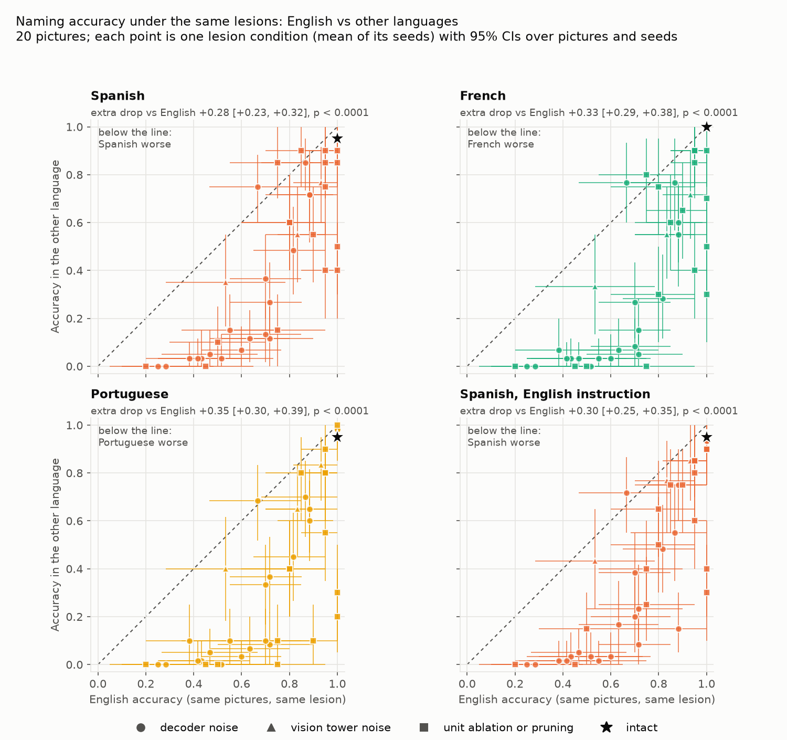
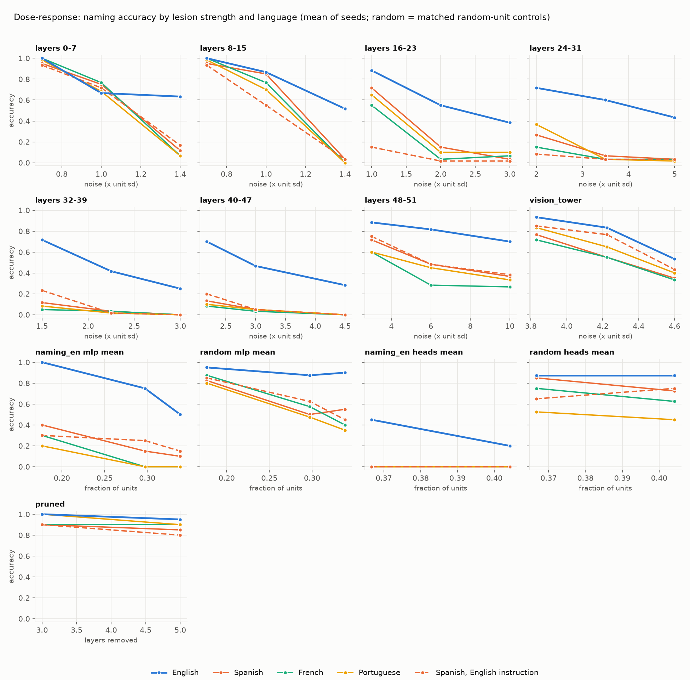
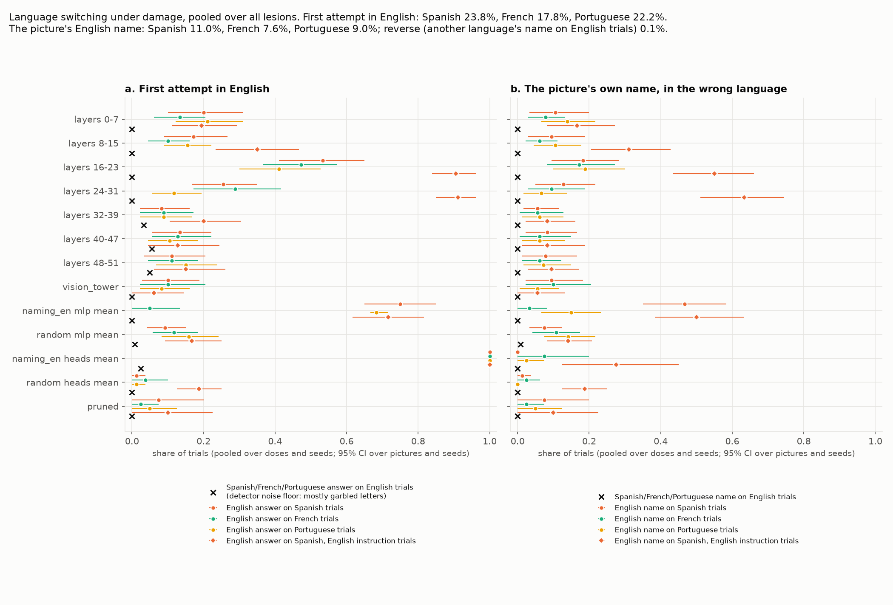
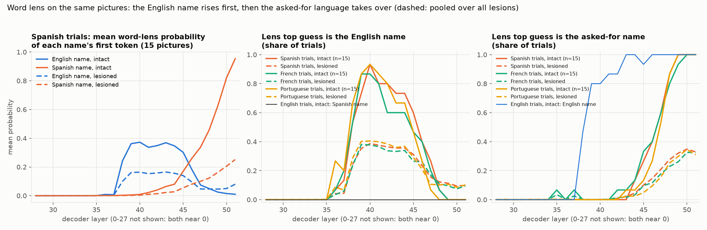

# Does damage hurt Spanish more than English? A controlled test

Measured on **Oct 26, 2026** with Muse Glimmer 30B (decoder in FP8, one NVIDIA L40S). Every number below is in `runs/bilingual/results.json`, and the figures are in `runs/bilingual/figures/`. Both are generated files and are not in the repository; the commands to rebuild them are at the end.

## Verdict

**The test supports the effect, and it is large.**

- **The setup.** The same pictures and the same damage were used in each language, with a matched one-word instruction.
- **The result.** Damage cost Spanish naming 28 more percentage points than English naming, on average.
  - The 95% confidence interval runs from 23 to 32 points.
  - All 19 pictures fared worse in Spanish than in English, and none fared better.
- **Other languages.** French and Portuguese show the same pattern, slightly stronger.
- **Switching.** When the damaged model failed in another language, it often answered in English. The reverse almost never happened.
- **The intact model.** Its "word lens" suggests why. On Spanish, French and Portuguese trials, the English name comes up first in the middle-to-late layers. The asked-for word takes over only in the last few layers.

The pattern echoes a common clinical observation in bilingual aphasia: the less dominant language is often more affected, and speakers may slip into the stronger one. That is an analogy, not evidence about brains. The caveats are at the end. The biggest ones:

- there are only 20 pictures;
- it is one model;
- the explanation from the word lens is consistent with the data but not proven.

## Why a new test

Earlier runs hinted at the effect, but they could not show it:

- **Noise on decoder layers 40–47 (×2.18):** English stayed at 16/20 but Spanish fell to 3/19 (`runs/lesion/demo_en`, `demo_es`).
- **"What can I cut?":** Spanish broke first, and cut models answered Spanish prompts in English ("Umbrella" for *paraguas*).
- **With its naming units ablated:** the model answered "The object is a cat" for *gato*.

Those runs differed in more than language:

- Each language had **different drawings**.
- The prompts were **worded differently**: the English one did not name a language, and the Spanish one was longer and stricter.
- The noise was **scaled by each set's own reference statistics**.

Any of these could make Spanish look more fragile.

## Design

### What was held constant

| | Earlier runs | This test |
|---|---|---|
| Pictures | different drawings per language | the same 20 drawings in every language: the kept pictures of the English demo set |
| Instruction | worded differently per language | one structure, written natively in each language: it names the language and asks for a single word with no article |
| Damage | noise scaled by each set's own statistics | **one lesion spec per condition**, applied fresh for each language. Mean and noise values come from reference statistics pooled over all four prompts. Noise restarts from the same seed in every language. |
| Scoring | Model Lab rules | the same rules (`naming_errors.classify`, first attempt, carrier phrase removed), with accepted names chosen to be equally lenient in every language |

| Variant | Instruction |
|---|---|
| English | Say the name of the object in a single word in English. Just the word, no article. |
| Spanish | Di el nombre del objeto con una sola palabra en español. Solo la palabra, sin artículo. (the Model Lab's tested wording) |
| French | Dis le nom de l'objet en un seul mot en français. Seulement le mot, sans article. |
| Brazilian Portuguese | Diga o nome do objeto com uma só palavra em português. Só a palavra, sem artigo. |
| Spanish, English instruction (control) | Say the name of the object in a single word in Spanish. Just the word, no article. |

The control variant asks for Spanish in English. It separates two questions: is the problem understanding a Spanish instruction, or producing a Spanish word?

### Names

The names in each language come from the Spanish, French and Portuguese demo sets, matched to the English picture by gloss.

- **Accepted alternates** were added on the same principle in every language (`EXTRA_NAMES` in `metalesionlab/bilingual.py`):
  - The kettle drawing also reads as a teapot, so *teapot*, *tetera*, *théière* and *bule* are all accepted.
  - *serrucho* is accepted for saw, and *bici* and *bike* for bicycle.
- **English spellings are not accepted in other languages.** The Portuguese set accepted "igloo" and "cactus", but here they count as English answers. Otherwise an English answer would score as correct in one language and not in another.
- **Names identical in two languages are kept.** *cactus* is the same word in Spanish, French and English, and *igloo* in French and English. These answers can't be told apart by language.

### Lesions

The plan was fixed before any lesioned non-English result was seen. Doses come from the earlier English severity runs: mild, moderate and severe in English.

| Family | Conditions | Seeds |
|---|---|---|
| Gaussian noise on every head and neuron of a band of 8 decoder layers | 7 bands: 0–7, 8–15, 16–23, 24–31, 32–39, 40–47, 48–51; 3 doses each, from ×0.7 to ×10 the unit's sd | 3 |
| Noise on the vision tower's output | ×3.83, ×4.22, ×4.6 | 3 |
| Naming-localizer mean ablation (`naming_en`, from English held-out drawings) | MLP neurons at the stored fractions 0.177, 0.297 and 0.339; attention heads at 0.367 and 0.404 | deterministic |
| Matched random-unit controls for each localizer lesion | same count of units in the same layers | 2 control seeds |
| Pruned models from "What can I cut?" (layers skipped, which matches real removal) | layers 27, 30, 47; the 5-layer cut 10, 27, 30, 35, 47 | deterministic |
| Robustness: noise and mean values from English-only or Spanish-only statistics | 4 of the conditions above, in English and Spanish | 3 |

In total there are 41 main lesion conditions, and with their seeds that makes 89 lesioned runs per language. Each run names 20 pictures, so each language has 1,780 lesioned trials. The test made 490 runs in all and took 58 minutes on axon-server02.

### Measures

- **Accuracy:** the first attempt, coded by `classify` with no meaning judge. "Correct" never depends on the judge.
- **Language of the answer.** Each word of the first attempt is assigned to a language:
  - the picture's names in each language decide first;
  - otherwise wordfreq decides: a word leans to a language when it is common there and at least 10 times more frequent there than in the other;
  - a short non-word that starts only one language's name also leans to that language (e.g. "Umb").

  Format labels ("Answer:"), words from the trial's own instruction (echoes) and chat-format leaks don't count as language.
- **English answer:** a first attempt whose words lean only to English, on a non-English trial.
- **English name:** an English answer that is the picture's English name ("Umbrella" for *paraguas*). The mirror measure on English trials is the picture's name in another language ("pina").
- **Word lens:** after every decoder layer, the probability of the first token of each language's name, plus the lens's top guess.
  - Pictures whose English and target names share a first token are dropped, which leaves 15 of 20 per language. They are bicycle, cactus, helicopter, igloo and saw for Spanish; bicycle, cactus, carrot, harp and igloo for French; and bicycle, cactus, harp, helicopter and igloo for Portuguese.

### Pre-specified primary measure

The primary measure was written into `scripts/bilingual_analyze.py` before any lesioned non-English result was seen.

- **The extra drop.** For each language, take the accuracy drop from intact in that language, minus the drop in English, on the same pictures. Average it over all 41 lesion conditions and their seeds.
- **Which pictures.** Only pictures named correctly by the intact model in both languages: 19 for Spanish and Portuguese (igloo drops out), 20 for French.
- **The 95% CI** comes from a bootstrap over pictures (the same resample for every condition) and over seeds within each condition.
- **The p-value** is a sign-flip permutation test over pictures.

Some measures were added or changed after the data were seen. They describe the result; they were not used to choose it.
- **The two narrower switch measures** (the picture's own name in the wrong language, and the wrong language after the first attempt) were added to separate real switches from garbled text.
- **The word-lens measures** (top guess, p ≥ 0.05) replaced a planned "English above target at any probability" share. In layers 0–37 both probabilities are about 10⁻⁸, so that share was coin-flip noise.

## Results

### 1. The intact model is near ceiling in every language

| | English | Spanish | French | Portuguese | Spanish, English instruction |
|---|---|---|---|---|---|
| Correct of 20 | 20 | 19 | 20 | 19 | 19 |
| The miss | none | igloo → "Igloo" | none | igloo → "Igloo" | igloo → "igloo" |
| Mean p(target's first token), last layer | 0.98 | 0.91 | 0.96 | 0.90 | 0.93 |

The only intact miss in any language is already an English answer: "Igloo" for *iglú* and *iglu*.

### 2. Primary result: damage costs other languages more than English

| Language | English accuracy, lesioned | Language accuracy, lesioned | Extra drop vs English [95% CI] | Pictures worse / better than English | p |
|---|---|---|---|---|---|
| Spanish | 0.73 | 0.45 | **+0.28** [+0.23, +0.32] | 19 / 0 (n = 19) | < 0.0001 |
| French | 0.72 | 0.39 | **+0.33** [+0.29, +0.38] | 20 / 0 (n = 20) | < 0.0001 |
| Portuguese | 0.73 | 0.38 | **+0.35** [+0.30, +0.39] | 19 / 0 (n = 19) | < 0.0001 |
| Spanish, English instruction | 0.73 | 0.43 | **+0.30** [+0.25, +0.35] | 19 / 0 (n = 19) | < 0.0001 |

- **All 20 pictures, igloo included:** Spanish +0.24 [+0.14, +0.31], with 19 pictures worse and 1 better.
- **Condition by condition:**
  - Spanish was worse than English in **35 of 41** conditions, tied in 3 and better in 3.
  - The three exceptions were noise at layers 0–7 ×1.0 and two random-head controls. All three had CIs that include zero.
  - In 25 conditions the CI excludes zero, and every one of them is Spanish worse.
- **French:** 37 worse, 2 better, 27 reliable.
- **Portuguese:** 37 worse, 1 better, 28 reliable.



`runs/bilingual/figures/accuracy_en_vs_lang.png`: each point is one lesion condition. Points below the diagonal mean the other language did worse than English under the same damage.

### 3. By lesion type

Each cell shows English vs the other language's accuracy, then the extra drop with its 95% CI. Pictures are those correct intact in both languages.

| Lesion family | Spanish | French | Portuguese | Spanish, English instruction |
|---|---|---|---|---|
| Noise, layers 0–7 | 0.77 / 0.64, +0.13 [+0.04, +0.23] | 0.77 / 0.61, +0.16 [+0.05, +0.27] | 0.77 / 0.59, +0.18 [+0.09, +0.27] | 0.77 / 0.63, +0.14 [+0.05, +0.24] |
| Noise, layers 8–15 | 0.78 / 0.63, +0.15 [+0.05, +0.24] | 0.79 / 0.59, +0.21 [+0.11, +0.29] | 0.78 / 0.57, +0.22 [+0.13, +0.30] | 0.78 / 0.53, +0.25 [+0.15, +0.36] |
| Noise, layers 16–23 | 0.61 / 0.30, +0.30 [+0.16, +0.46] | 0.61 / 0.22, +0.39 [+0.23, +0.54] | 0.61 / 0.27, +0.34 [+0.23, +0.46] | 0.61 / 0.06, +0.54 [+0.40, +0.68] |
| Noise, layers 24–31 | 0.61 / 0.13, +0.48 [+0.33, +0.61] | 0.58 / 0.07, +0.51 [+0.36, +0.66] | 0.61 / 0.14, +0.47 [+0.33, +0.60] | 0.61 / 0.05, +0.56 [+0.40, +0.70] |
| Noise, layers 32–39 | 0.49 / 0.05, +0.43 [+0.31, +0.56] | 0.46 / 0.03, +0.43 [+0.31, +0.56] | 0.49 / 0.04, +0.45 [+0.31, +0.59] | 0.49 / 0.09, +0.40 [+0.28, +0.52] |
| Noise, layers 40–47 | 0.51 / 0.06, +0.44 [+0.29, +0.60] | 0.48 / 0.04, +0.44 [+0.29, +0.61] | 0.51 / 0.05, +0.46 [+0.29, +0.62] | 0.51 / 0.09, +0.42 [+0.29, +0.56] |
| Noise, layers 48–51 | 0.80 / 0.55, +0.25 [+0.12, +0.37] | 0.80 / 0.38, +0.42 [+0.26, +0.57] | 0.80 / 0.47, +0.32 [+0.15, +0.49] | 0.80 / 0.56, +0.23 [+0.09, +0.38] |
| Noise, vision tower | 0.77 / 0.58, +0.19 [+0.05, +0.33] | 0.77 / 0.53, +0.23 [+0.09, +0.39] | 0.77 / 0.65, +0.12 [+0.00, +0.25] | 0.77 / 0.72, +0.05 [−0.06, +0.19] |
| Naming localizer, MLP mean | 0.75 / 0.23, +0.53 [+0.40, +0.65] | 0.75 / 0.10, +0.65 [+0.53, +0.77] | 0.75 / 0.05, +0.70 [+0.60, +0.81] | 0.75 / 0.23, +0.53 [+0.42, +0.63] |
| Random MLP units, matched | 0.92 / 0.65, +0.27 [+0.16, +0.39] | 0.91 / 0.62, +0.29 [+0.16, +0.42] | 0.92 / 0.57, +0.35 [+0.24, +0.46] | 0.92 / 0.68, +0.25 [+0.12, +0.37] |
| Naming localizer, heads mean | 0.34 / 0.00, +0.34 [+0.18, +0.50] | 0.33 / 0.00, +0.33 [+0.17, +0.50] | 0.34 / 0.00, +0.34 [+0.18, +0.50] | 0.34 / 0.00, +0.34 [+0.18, +0.50] |
| Random heads, matched | 0.87 / 0.80, +0.07 [−0.04, +0.17] | 0.88 / 0.69, +0.19 [+0.05, +0.33] | 0.87 / 0.49, +0.38 [+0.30, +0.46] | 0.87 / 0.72, +0.14 [+0.00, +0.29] |
| Pruned (2 cuts) | 1.00 / 0.92, +0.08 [+0.00, +0.21] | 0.97 / 0.90, +0.07 [−0.05, +0.20] | 1.00 / 0.95, +0.05 [+0.00, +0.13] | 1.00 / 0.89, +0.11 [+0.00, +0.24] |

**Where the gap is largest.** Noise on the middle and late decoder (layers 24–47) leaves English at about half its pictures and the other languages at almost nothing.

**Where it is smallest:**
- the pruned models, about one picture in 20;
- noise on the vision tower, which damages the input before any language processing.

Vision damage still costs Spanish and French more, and Portuguese borderline more (CI from 0.00). When Spanish is asked in English, it barely does (+0.05, CI includes zero).

**The naming localizer.** It was built from English trials and spares English at its mildest dose:
- **MLP fraction 0.177:** English stays at 20/20, but Spanish falls to 8/20, French to 6/20 and Portuguese to 4/20.
- **Matched random units:** Spanish keeps 18/20 and 15/20.
- **The heads localizer:** every non-English answer turns into English narration ("The user asks: ...") and scores 0, while English keeps 45% and 20% at the two doses.

**The original observation.** The condition from the original observation (noise on layers 40–47, ×2.18) replicates under the controlled design:
- English 0.70 [0.52, 0.85] vs Spanish 0.13 [0.02, 0.27], averaged over 3 seeds;
- French 0.08 and Portuguese 0.10.

### 4. Dose-response



**Mild doses.** At the mildest doses (bands 0–7 and 8–15 at ×0.7), every language stays at or near ceiling.

**×1.0.** At the next step the gap is small or absent:
- layers 0–7: English 0.67, Spanish 0.75 (the one nominal reversal);
- layers 8–15: English 0.87, Spanish 0.85, Portuguese 0.70.

**Stronger doses.** One step further (×1.4), the other languages collapse while English degrades gradually:
- layers 0–7: English 0.63, Spanish 0.12;
- layers 8–15: English 0.52, Spanish 0.03.

**Bands 24–47.** Even the mildest dose tested leaves English at 0.70–0.72 but drops the other languages to 0.05–0.37.

So the other languages don't degrade in proportion to English. Once the damage is past a threshold, they fall off a cliff that English doesn't reach.

### 5. Switching into English



Pooled over all lesions, 1,780 trials per language:

| | Spanish | French | Portuguese | Spanish, English instruction | Reverse: English trials |
|---|---|---|---|---|---|
| First attempt in English (other language on English trials) | 23.8% [20.6, 27.6] | 17.8% [15.2, 20.8] | 22.2% [20.0, 24.5] | 36.1% [32.8, 40.4] | 1.3% [0.6, 2.1]* |
| The picture's own name in the wrong language | 11.0% [8.4, 14.2] | 7.6% [5.2, 10.3] | 9.0% [6.8, 11.3] | 23.9% [21.0, 27.0] | **0.1%** [0.0, 0.4] (2 of 1,780, both "pina") |
| Share of errors that are English answers | 35% [32, 38] | 27% [25, 30] | 30% [27, 33] | 55% [53, 58] | not applicable |
| Mixed answers (words of both languages) | 2.0% | 1.6% | 1.7% | 2.9% | 0.6% |
| The wrong language after the first attempt (e.g. "anclaría … Wait object is anchor") | 20.6% | 15.6% | 17.2% | 21.7% | 0.0% |

\* On English trials, almost all detector hits are garbled letter strings ("har' a l e a r p s"), where single letters happen to lean to French or Portuguese. Read this as the detector's noise floor. The clean comparison is the picture's own name in the wrong language: 11% one way, 0.1% the other.

**Two kinds of English answer, in roughly equal numbers:**
- **The picture's English name**, sometimes in an English carrier phrase. Examples are "Umbrella" for *paraguas* and "The object is a cat" for *gato*. This is the earlier observation, and the model clearly recognized the object.
- **English narration of the task**, such as "The user asks for the name of the object in Spanish…". This is the voice of Glimmer's reasoning channel leaking into the answer. When the damaged model narrates, it almost always does so in English, whatever was asked:

  | Trials | Narration in English | Narration in the asked-for language |
  |---|---|---|
  | Spanish | 154 | 10 |
  | French | 123 | 2 |
  | Portuguese | 105 | 0 |

Under late-layer noise, the first attempt is often a garbled target-language word ("anclaría", "cuperón"), followed by a self-correction in English: "Wait object is spoon".

### 6. Asking for Spanish in English

With the instruction in English, Spanish accuracy under damage is about the same as with the Spanish instruction: 0.43 vs 0.45. Its extra drop is +0.30 [+0.25, +0.35].

So the deficit is in producing the Spanish word, not in reading a Spanish instruction. With the English instruction the model falls back to English even more often: the picture's English name appears on 23.9% of trials, against 11.0%.

### 7. Error types

Pooled over all lesions, % of 1,780 trials. Without the meaning judge, Semantic and Unrelated are merged: Spanish, French and Portuguese meaning relations are only judged by Muse Spark, which was not used here.

| Code | English | Spanish | French | Portuguese | Spanish, English instruction |
|---|---|---|---|---|---|
| Correct | 68.7 | 39.0 | 34.6 | 35.8 | 36.6 |
| English name (switch) | not applicable | 10.3 | 8.0 | 9.2 | 23.3 |
| Other English (narration, English words) | not applicable | 11.1 | 9.7 | 9.9 | 11.9 |
| Mixed language | not applicable | 1.5 | 2.0 | 1.6 | 1.4 |
| Real word, Semantic or Unrelated | 3.5 | 4.7 | 7.2 | 7.3 | 5.2 |
| Formal | 2.9 | 4.0 | 4.6 | 3.8 | 4.2 |
| Mixed (meaning + sound) | 0.4 | 0 | 0 | 0 | 0 |
| Nonword | 7.0 | 10.0 | 6.8 | 8.3 | 9.3 |
| Neologism | 1.2 | 2.6 | 4.3 | 4.8 | 2.2 |
| Description (incl. narration and echoes in the same language) | 14.2 | 15.5 | 22.2 | 18.5 | 5.2 |
| No response | 2.2 | 1.3 | 0.6 | 0.7 | 0.8 |

The plain PNT codes hide the switches. An English answer on a Spanish trial gets coded as Formal, Nonword or Neologism, because wordfreq lists many English words in Spanish too: "Umbrella" for *paraguas* comes out as Formal. The table above codes switches first.

French gives more Descriptions because, under the MLP localizer lesion, it echoes its own instruction ("Dis le nom de l'objet…") instead of switching.

### 8. Word lens: English comes first



**In the intact model, on Spanish trials** (15 testable pictures):

- **Up to about layer 37**, neither name has any probability.
- **From layer 38**, the English name rises:
  - its mean probability peaks at 0.37 at layer 40;
  - it is the lens's top guess on 93% of trials at layer 40.
- **The Spanish name** becomes the top guess on most pictures only from layer 47, and ends at p = 0.95.
- **Every testable picture (15 of 15)** has the English name as the lens's top guess at some layer before the Spanish name takes over. Two examples:
  - *pineapple* leads from layer 36 to 47, then *piña* takes over at 48;
  - *harp* leads from layer 40 to 47, then *arpa* takes over at 49.
- **French and Portuguese** look the same: 14 of 15 pictures, peak 87–93% at layers 39–40, and the target leads from layer 47.

**On English trials**, the English name becomes the top guess on most pictures from layer 39, eight layers earlier than the other languages' names. The Spanish name is never the top guess at any layer (0 of 15 pictures intact; 0.7% of lesioned trials).

**So the asked-for word appears later.** Answering in a language other than English takes a late extra step: the model reaches the English name around layer 38–40 and only then turns it into the asked-for word. That leaves Spanish, French and Portuguese answers only the last five layers as the top guess. This matches the "latent English" finding of Wendler et al. (2024) for Llama 2.

**Under damage** (pooled over all lesions, Spanish trials):

| | Intact | Damaged |
|---|---|---|
| English name is the top guess at any layer | 100% of trials | 52% |
| Spanish name is the top guess at the last layer | 100% | 33% |
| Mean final p, Spanish name | 0.95 | 0.25 |
| Mean final p, English name | 0.01 | 0.08 |

For comparison, under the same damage the English name finishes on top on 55% of English trials.

**The lens does not predict which pictures switch.** How strongly the intact lens favors English at a picture (its peak English probability) does not reliably predict that picture's switch rate under damage. The Spearman correlations over 15 pictures are:

- Spanish 0.29 (p = 0.29);
- French −0.37 (p = 0.17);
- Portuguese 0.63 (p = 0.012, uncorrected, one of four tests);
- Spanish with the English instruction 0.42 (p = 0.12).

The English pivot is a property of every non-English trial, and it fits the fragility, but this test doesn't show that a stronger pivot means more switching.

### 9. Robustness to the reference statistics

The same four conditions were run in English and Spanish with three sets of reference statistics. The four conditions were noise at 0–7 ×1, noise at 40–47 ×3, the vision tower at ×4.22, and the MLP localizer at 0.297.

| Reference statistics | Spanish extra drop [95% CI] |
|---|---|
| Pooled over all prompts (main analysis) | +0.29 [+0.19, +0.41] |
| English prompt only | +0.29 [+0.20, +0.38] |
| Spanish prompt only | +0.26 [+0.17, +0.36] |

The effect does not depend on which language the lesion was calibrated in.

## What this means

**In plain language:**
- **Same damage, worse outcome.** On the same pictures, a given amount of damage costs Glimmer far more in Spanish, French and Portuguese than in English.
- **How it fails.** When the other language fails, the model often answers in English, either with the right name in English or by narrating the task in English. A damaged English answer almost never comes out in another language.
- **Why it might be so.** The intact model appears to reach the English name first and translate it at the end. That makes every non-English answer depend on a late extra step, and when damage disrupts that step, English comes out.

**For aphasia research, this is an analogy to bilingual aphasia, not evidence about it.** Glimmer behaves like a speaker whose dominant language is English. Its training data are presumably English-heavy, as for most large models, but that wasn't checked here.

In bilingual aphasia:
- Outcomes vary, and parallel impairment of both languages is common.
- When the languages are affected differently, the language with higher pre-stroke proficiency and use tends to be better preserved (Kuzmina et al., 2019, meta-analysis).
- Pathological switching and mixing into another language is reported (Fabbro, 2001).

The model reproduces both the asymmetry and the direction of switching. It also gives a concrete, inspectable mechanism, which brains do not: an English intermediate in the late layers.

## Caveats

- **n = 20 pictures,** and 19 for the Spanish and Portuguese primary analysis. One picture moves a language's accuracy by 5 points.
  - The intervals account for which pictures happened to be chosen and for noise seeds.
  - They do not treat the 41 conditions as a sample of all possible lesions: the conditions are a fixed, hand-chosen set.
  - Per-family intervals are exploratory and not corrected for multiple comparisons.
- **One model, one precision.** Muse Glimmer 30B has its decoder in FP8. Other models, or BF16, could differ.
- **Prompt wording.** Each language has one instruction.
  - The prompts are matched in structure and intact accuracy is 19–20 of 20 everywhere, but wording effects under damage were not tested beyond the English-instruction control.
  - The English prompt names "English", unlike the Model Lab's English prompt.
- **Doses were chosen from earlier English runs.** They span mild to severe for English. A plan calibrated to Spanish would put more conditions where English is at ceiling. That would likely widen the gap, not close it.
- **No meaning judge.**
  - Accuracy, the switch measures and the extra-drop statistics don't depend on a judge.
  - Semantic vs Unrelated does, so those codes are merged here. Spanish, French and Portuguese meaning relations would need the Muse Spark judge.
  - No Meta API calls were made: $0.
- **The switch detector is rule-based** (word lists and frequencies).
  - It ignores format labels, instruction echoes and chat-format leaks.
  - On garbled letter strings it has a noise floor of about 1% (the reverse direction).
  - The picture-name measure is the cleaner one: 11% one way, 0.1% the other.
- **The word lens reads only first tokens.**
  - 5 pictures per language were dropped because their names share a first token with English.
  - Single-letter tokens such as "G" or "C" add some noise to the probabilities.
  - The lens shows where a name is decodable, not that the model uses it causally. The pivot was not ablated.
- **Pruning was done by skipping layers.** That matches real deletion exactly (checked in "What can I cut?"). The pruned models are only mildly impaired, so they say little either way.
- **Answers are typed, not spoken.** Scoring is the Model Lab's written-answer path, capped at 12 new tokens.
- **No participant data was used.** Every picture was made by Muse Image for this project.

## Reproduce

```bash
# GPU box: needs runs/sets/demo_{en,es,fr,pt} and runs/localizers/naming_en.pt; NLTK_DATA with WordNet
export HF_HOME=$HOME/.cache/huggingface PYTHONPATH=$PWD
python scripts/bilingual_run.py stats        # reference statistics: pooled, English-only, Spanish-only
python scripts/bilingual_run.py pilot        # intact naming per language, printed per picture (prompt check)
python scripts/bilingual_run.py run          # the fixed plan, ~1 h on an L40S; raw runs -> runs/bilingual/raw/
python scripts/bilingual_run.py ids          # first-token ids of every name (tokenizer only)

# Locally, after copying runs/bilingual back
python scripts/bilingual_analyze.py          # -> runs/bilingual/results.json
python scripts/bilingual_figures.py          # -> runs/bilingual/figures/*.png
pytest tests/test_bilingual.py
```

Code: `metalesionlab/bilingual.py` (items, prompts, response language, word-lens readout, statistics), `scripts/bilingual_run.py`, `scripts/bilingual_analyze.py`, `scripts/bilingual_figures.py`.

## References

- Fabbro, F. (2001). The bilingual brain: Bilingual aphasia. *Brain and Language*, 79(2), 201–210.
- Kuzmina, E., Goral, M., Norvik, M., & Weekes, B. S. (2019). What influences language impairment in bilingual aphasia? A meta-analytic review. *Frontiers in Psychology*, 10, 445.
- Wendler, C., Veselovsky, V., Monea, G., & West, R. (2024). Do Llamas work in English? On the latent language of multilingual transformers. *ACL 2024*. arXiv:2402.10588.
