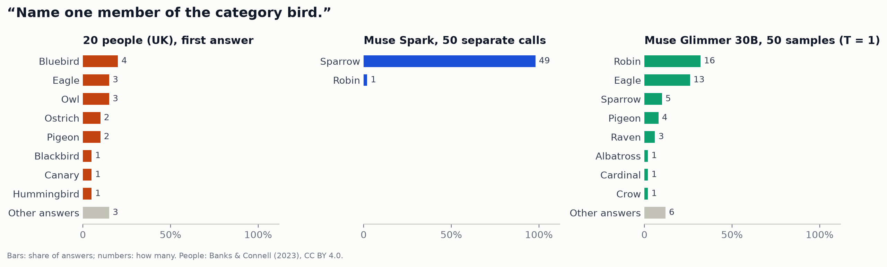
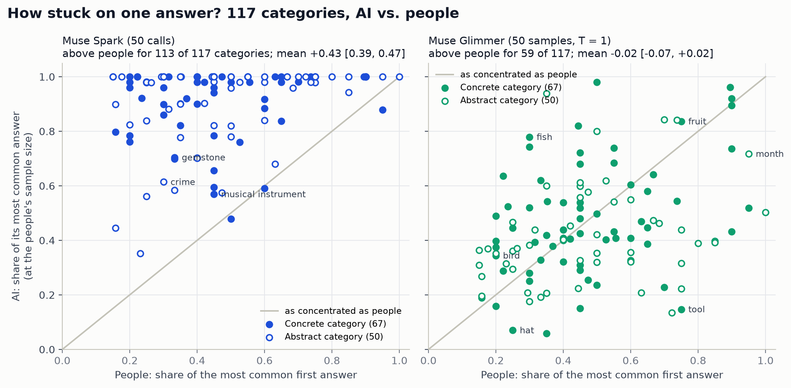

# Plato's Bird

Plato's Chair found that Muse Image *draws* the textbook chair. Does the AI also *think* in textbook examples? Asked to name a bird, is it far more stuck on one answer than people are?

Wittgenstein argued that categories such as "game" have no definition, only family resemblances. Rosch showed that they still have best examples. A person's first answer in a category production task measures that pull toward the best example, and we compare the AI's pull with people's.

**Short answer:** Muse Spark is far more stuck on one answer than people are, but the narrowness is in its default answer, not in what the model knows.

- **Spark gives one answer almost every time.** Across 117 categories, Spark's most common answer takes **90%** of its answers. People's most common first answer takes **48%** (difference +0.43 [0.39, 0.47], 95% CI over categories).
  - Spark is more concentrated in **113 of 117** categories.
  - Its answers have 0.33 bits of entropy against people's 2.13.
  - It gave the same answer all 50 times in 51 categories. People were unanimous in one (positive emotion: "happy").
  - Name a bird: 20 people gave 11 different birds; Spark said "sparrow" 49 times out of 50.
- **Concrete and abstract categories show the same gap.** Spark's lead is +0.44 for concrete categories and +0.41 for abstract ones (difference −0.03 [−0.11, 0.05]).
  - The predicted abstract-category effect is absent.
  - The "twist" seen with the chairs, where people are nearly as concentrated as the AI for concrete things, is absent too.
- **Meta's open model is as varied as people.** Muse Glimmer 30B's own probabilities for its first answer are as spread out as people's answers: top share 0.49 against 0.48 (+0.01 [−0.03, 0.05]).
  - Its probabilities rank a category's members much as people's production frequencies do (median rho 0.58).
  - How varied its answers look depends on the sampling temperature. At 0.7 it is clearly more concentrated than people (+0.13 [0.09, 0.18]); at 1.5 it is far less concentrated, with junk answers.
  - Spark barely moves with temperature. At 1.5 its top answer still takes 86% of answers (91% at its default), and the extra randomness mostly adds garbled answers.
- **Spark picks a good example, not an odd one.** Its top answer is rated as typical as people's favourite (4.74 against 4.78 out of 5), and 73% of people named it at some point.
  - It matches people's most common first answer in only 71 of 117 categories.
  - Some mismatches look cultural: Spark is American, the people are British. Examples: aspirin vs. paracetamol, toaster vs. kettle, "soccer".
- **Drawing and naming defaults match in only half the categories, 6 of 12.** Muse Image draws what Spark names for fruit, bird, vegetable, musical instrument, sport and furniture. It does not for the rest:
  - Spark names a car, but the drawings are mostly pickup trucks.
  - It names a hammer, but draws wrenches as often.
  - It names a rose, but draws daisies.
  - It names chess, but draws Super Mario.

Figures:
- **In this repository:** the three charts, in `docs/figures/plato_bird/`.
- **Outside it,** in `PlatosChair/bird/figures/`:
  - the charts as SVG;
  - `name_<category>.png` for 8 categories;
  - `pictures.png`, all 144 doodles.

The web page is at `/plato/bird`.

## Method

The plan was pre-registered and committed before any AI answers were collected: `docs/plato_bird_plan.md`, commit 094ad5d.

| Step | What we did |
|---|---|
| People | Banks & Connell (2023) category production norms: 117 categories (67 concrete, 50 abstract), 20 UK adults per category. Each person named aloud as many members as they could in 60 seconds. We use each person's **first** answer from the trial-level file (13–20 per category after the authors' exclusions). Production frequency is the number of people who named a member at any point. Typicality ratings (1–5) came from separate raters in the same study. |
| Prompt | *"Name one member of the category bird. Answer with one word or a short name only."* The category names are as in the norms, including UK spelling. "Game", Wittgenstein's example, is asked of the AI only, because the norms lack it. |
| Muse Spark | `muse-spark-1.3`: 50 separate calls per category (5,900 calls), default sampling, reasoning effort `minimal`. The pre-registered pilot (10 calls at $0.00032 each) fixed n = 50. The full run averaged $0.00037 a call. |
| Muse Glimmer | Muse Glimmer 30B, FP8, self-hosted on one L40S, $0. The reasoning channel is skipped by pre-filling the answer header. **(a) Logit distribution:** the next-token distribution at the first answer position. The top tokens (until 99% of the mass, at most 64; mean covered mass 93%) are each continued greedily to a full answer. **(b) Samples:** 50 per category at temperatures 0.7, 1.0 and 1.5, sampled from the model's own logits with top-k and top-p off. |
| Normalizing | The same function for people and AI (`metalesionlab/plato_bird.py: normalize`): - keep the first item; - drop markdown, quotes, parentheticals, articles and a short "label:" prefix; - lowercase; - singularize, with exception lists; - apply a hand-reviewed **synonym map** that merges only names of the same thing: US/UK names (eggplant = aubergine, soccer = football, wrench = spanner), spellings, short forms, and noun/adjective forms of the same feeling or quality (happiness = happy) as the norms' own referential coding does; - per category, merge forms that differ only in spacing ("blue bird" = "bluebird"), or by the category's head noun when both forms occur ("oak tree" = "oak", "top" = "top hat"). A merged group is named by the norms' own referential member name where there is one. The maps are listed in full in the code and in `results.json` (`aliases`). |
| Equal n | Small samples look more concentrated by chance. So the AI's 50 answers are subsampled without replacement to each category's number of people (1,000 draws), and Glimmer's distribution is sampled at the same n. The unbiased match probability Σc(c−1)/n(n−1) does not depend on n and uses all answers. |
| Measures | - Top-answer share ("dominance"). - Shannon entropy (bits). - Distinct answers. - Match probability. - Whether the AI's top answer is people's top first answer. - How many people named the AI's top answer, and its typicality. - Within-category Spearman correlation of the AI's answer probability with production frequency and with typicality. - Coverage: the share of AI answers any of the 20 people produced. |
| Statistics | Category is the unit. We report the mean AI − human difference with a 10,000-resample bootstrap CI over categories, counts of categories, and a Wilcoxon signed-rank p. Concrete vs. abstract compares the mean gap, with the bootstrap resampling within each domain. |
| Pictures | Muse Image (`muse-image-1.0`) drew 12 categories with the Plato's Chair doodle prompt: 3 calls of n = 4, so 12 pictures each, 144 in all. - Muse Spark (vision) and Glimmer each said which member each picture shows: *"Someone was asked to draw a fruit. Which fruit is in this drawing? ..."* - Generic labels ("a fish", "puppy") are counted as generic. - A modified label collapses to its head noun when that head is itself an answer in the category ("acoustic guitar" → guitar, "claw hammer" → hammer). - "a dog" is compared with the norms' "breed of dog", and "a piece of furniture" with "furniture". |

Code:
- `metalesionlab/plato_bird.py`
- `scripts/plato_bird_spark.py` (paid steps)
- `scripts/plato_bird_glimmer.py` (GPU)
- `scripts/plato_bird_analyze.py`
- `scripts/plato_bird_figures.py`

Raw human files, AI answers and pictures live in `PlatosChair/bird/` (`$PLATO_BIRD_DIR`). The repository holds derived statistics only (`public_data/plato_bird.json`).

## Pre-registered predictions

| Prediction | Result |
|---|---|
| P1: the AI's top answer takes a larger share than people's, with lower entropy, for Spark and for Glimmer at T = 1 | **Spark: yes**, by a wide margin (+0.43 [0.39, 0.47]; entropy −1.80 [−1.96, −1.65] bits). **Glimmer at T = 1: no**, it is as varied as people (−0.02 [−0.07, 0.02]; entropy +0.16 [−0.02, 0.34]). |
| P2: the gap is larger for abstract categories | **No.** Abstract − concrete gap in dominance: Spark −0.03 [−0.11, 0.05]; Glimmer (logits) −0.06 [−0.14, 0.02]. |
| P3 (possible twist): for concrete categories people are nearly as concentrated as the AI | **No.** People's mean top share is 0.47 for concrete and 0.48 for abstract categories; Spark's lead is +0.44 for concrete ones. |
| P4: for most of the 12 drawn categories, the drawn favourite is Spark's named favourite | **Half: 6 of 12.** |

## Findings

**Concentration, 117 categories, at people's sample size**

| Source | Top-answer share | AI − people | AI higher / lower (of 117) | Entropy (bits) | Distinct answers (of ~20) |
|---|---|---|---|---|---|
| People (first answer) | 0.48 [0.44, 0.52] | | | 2.13 [1.97, 2.29] | 7.1 |
| Muse Spark | **0.90** [0.88, 0.93] | **+0.43** [0.39, 0.47] | 113 / 3 | 0.33 | 1.6 |
| Glimmer, logit distribution | 0.49 [0.45, 0.52] | +0.01 [−0.03, 0.05] | 68 / 49 | 2.08 | 6.7 |
| Glimmer, samples T = 1 | 0.45 [0.42, 0.49] | −0.02 [−0.07, 0.02] | 59 / 57 | 2.29 | 7.9 |
| Glimmer, samples T = 0.7 | 0.61 [0.57, 0.65] | +0.13 [0.09, 0.18] | 84 / 33 | 1.55 | 5.0 |
| Glimmer, samples T = 1.5 | 0.26 [0.23, 0.29] | −0.22 [−0.26, −0.18] | 16 / 101 | 3.35 | 13.3 |

**Match probability.** The n-free measure agrees:
- Spark +0.55 [0.50, 0.59];
- Glimmer logits +0.01 [−0.04, 0.05];
- Glimmer T = 1 −0.03 [−0.07, 0.02].

**Wilcoxon p.** Spark and Glimmer T = 0.7 and 1.5: < 10⁻⁶. Glimmer logits 0.55; Glimmer T = 1 0.44.

**Which answer?**
- **Prototype agreement.** Spark's top answer is people's most common first answer in 71 of 117 categories (concrete 41/67, abstract 30/50). Glimmer's logits agree with people in 58, and Spark's top answer agrees with Glimmer's in 70.
- **Is it a good example?**
  - On average, 73% [68, 77] of people named Spark's top answer at some point in their minute.
  - Its typicality is 4.74, against 4.78 for people's favourite (−0.03 [−0.08, 0.02]).
  - So Spark's default is a textbook member, just not always the one British adults say first.
- **Graded structure.** Within a category, Glimmer's probability for each member people produced tracks:
  - how many people named it: median rho **0.58** [0.54, 0.60], positive in 115 of 117;
  - its typicality: 0.55 [0.50, 0.60], positive in 108 of 115.
  
  Spark's sample shares track them less (0.33 and 0.38) because most members get zero of 50.
- **Coverage.** At least one of the 20 people named 99% of Spark's answers and 79% of Glimmer's T = 1 answers.

**Striking categories.** Each pair below is people's top first answer and share, then Spark's top answer and share.
- **bird:** people bluebird 20% (11 different birds), Spark sparrow 98%. Glimmer's probabilities: robin 48%, eagle 16%, sparrow 9%.
- **fish:** people goldfish 30%, Spark salmon 100%.
- **emotion:** people happy 75%, Spark joy 100%.
- **positive emotion:** people happy 100%, Spark joy 100%. This is the one category where people are unanimous.
- **hat:** people top hat 25% (then cap, baseball cap, bowler), Spark fedora 98%.
- **flower:** people daisy 30% and rose 30%, Spark rose 100%. Muse Image draws daisies.
- **medical specialty:** people doctor 15%, Spark cardiology 100%.
- **clothing:** people hat 20%, Spark shirt 100%.
- **Cultural defaults:**
  - drug: people paracetamol 40%, Spark aspirin 100%;
  - kitchen appliance: people kettle 30%, Spark toaster 100%;
  - sport: Spark says "Soccer" 49 times (merged with football).
- **The three where Spark is less concentrated than people:**
  - dairy product: milk 95% vs. 88%;
  - rodent: people rat 60%, Spark mouse 58%;
  - weapon: people gun 50%, Spark sword 46%.
- **game (AI only):** Spark says chess 49 of 50 times. Glimmer reads "game" as hunted animals or gives scattered answers (animal 19%, aardvark 7%).

**Temperature and fair framing.** "The AI is narrow" means its default answer is narrow, and diversity depends on how it samples.
- **Glimmer's probabilities re-weighted to other temperatures:**

  | Temperature | Mean top share | Entropy (bits) |
  |---|---|---|
  | 0.5 | 0.73 | 1.21 |
  | 0.7 | 0.61 | 1.85 |
  | 1.0 | 0.47 | 2.69 |
  | 1.5 | 0.32 | 3.61 |
  | 2.0 | 0.24 | 4.08 |

  These use the population measures, not equal n. The samples agree.
- **Spark at temperature 1.5** (figure: `figures/plato_bird/temperature.png`; exploratory: 24 categories × 20 calls, $0.33): its top answer takes 0.86 [0.79, 0.92] of answers, against 0.91 [0.85, 0.96] for its default answers at the same n (−0.05 [−0.08, −0.03]).
  - The extra answers are mostly garbled strings: "Se trav Node" (bird), "Skurillé" (sport), "Persistence" (metal).
  - The categories still read sparrow, labrador, joy, salmon, rose, apple, chair, fedora, chess.
  - So Spark's narrowness is not a low sampling temperature. It looks like what tuning and reasoning make of the answer distribution, which Glimmer's raw probabilities do not show.

**Pictures: the drawn default against the named default.** Drawn labels are Spark's (vision); Glimmer's labels agree on the drawn favourite in 11 of 12 (not the dog).

| Picture | Muse Image draws (of 12) | Spark names (of 50) | People's first answer | Same as named? |
|---|---|---|---|---|
| a fruit | apple 6 (strawberry 3, banana 3) | apple 50 | apple | yes |
| a bird | sparrow 7 (one songbird, 12 times) | sparrow 49 | bluebird | yes |
| a vegetable | carrot 7 (mushroom, tomato, broccoli) | carrot 50 | carrot | yes |
| a vehicle | **pickup truck 6**, car 4 | car 50 | car | no |
| a musical instrument | guitar 10 | guitar 25 / piano 25 | guitar | yes |
| a game | **Super Mario-style platformer 9**, maze 1 | chess 49 | (no norms) | no |
| a sport | football 8 (basketball 4) | football 49 | football | yes |
| a tool | **spanner/wrench 6**, hammer 4, screwdriver 2 | hammer 50 | hammer | no |
| a flower | **daisy 9** | rose 50 | daisy / rose | no |
| a dog | a generic dog or puppy 10; beagle 1, dachshund 1 | labrador 43 | labrador | no |
| a fish | tuna 5 (generic 5, goldfish 2) | salmon 50 | goldfish | no |
| a piece of furniture | chair 10 | chair 50 | chair | yes |

So the picture model has defaults of its own: the image model's prototype is not simply the chat model's word. The bird is the starkest case: Muse Image draws the same little songbird 12 times, and Spark names a sparrow 49 times.

**Robustness**

- **The authors' own coding.** With the authors' referential first-rank counts in place of our normalization of the trial data, Spark − people is +0.42 [0.38, 0.46], and entropy −1.78. Our coding differs from theirs by at most +0.005 in mean dominance.
- **Valid answers only** (exploratory, not pre-registered). Muse Glimmer judged every answer (*"Is X a member of the category Y? ... Answer yes or no"*, P(yes) from the logits, threshold 0.5), applied to people and models alike.
  - Valid answers: people 95%, Spark 99%, Glimmer T = 1 94%.
  - Keeping only valid answers: Spark − people +0.41 [0.37, 0.46]; Glimmer T = 1 − people −0.02 [−0.06, 0.03].
  - The judge is lenient ("Nike" as an art form passes at 0.51) but catches real errors ("1" as a prime 0.05, spider as an insect 0.01, cockroach as a rodent 0.07).
- **Unusable answers.** Spark had none; Glimmer had 15 of 5,900 at T = 1.

## Caveats

- **Not the same task.** People named members aloud for 60 seconds, and we use their first. The AI answered one question per call. Fluency order and single-answer choice need not share a prototype, though the first answer is the standard measure of the pull toward it.
- **Culture.** The people are 20 UK adults per category. Spark seems tuned on American English: soccer, aspirin, toaster. We merged pure naming differences (soccer = football) but not cultural defaults (aspirin vs. paracetamol), and some prototype mismatches are partly cultural. The concentration measures do not depend on which member is the favourite.
- **Small human samples.** 13–20 people per category. Every comparison is made at that n (subsampling), and the n-free match probability agrees.
- **Different access to the two AIs.** Spark is the hosted chat model with minimal reasoning and default sampling (its default temperature is not documented). Glimmer is queried with its reasoning skipped and its raw probabilities read directly. Part of the Spark–Glimmer difference may be the reasoning step or tuning rather than the model size.
- **Glimmer's logit distribution is approximate.** Each first token is continued greedily, so "S…" counts as "Sparrow" even if it could also begin "Swan". The samples, which need no such approximation, give the same result (0.45 against 0.49).
- **Normalization judgments.** The synonym map and the merges are ours, reviewed by hand, and listed in the code. They merge only names of the same thing. "joy" and "happy" are kept apart (the authors also kept "joy" separate under "emotion"), which matters for prototype agreement but not for concentration.
- **Picture labels are a model's reading.** Many doodles get a generic label ("a dog", "a fish"). For the dog, Muse Image draws a generic cartoon puppy rather than any breed. Twelve pictures per category is small.
- **One prompt wording.** "Name one member of the category X" is a slightly formal phrasing. "Game" is ambiguous for a model (Glimmer read it as game animals).

## Cost

$4.11 of a $5 budget. The shared ledger stood at about $43 at the end, which includes other agents' work.

| Item | Cost |
|---|---|
| Muse Spark, 5,900 naming calls | $2.18 |
| Muse Image, 144 doodles | $1.44 |
| Spark, temperature check (480 calls) | $0.33 |
| Spark vision, 144 picture labels | $0.16 |

Glimmer ran on axon-server02 (L40S) at $0: the logit distributions, 17,700 samples, the picture labels and 7,650 judge prompts.

## Data and credit

**Human data.** Banks, B., & Connell, L. (2023). Category production norms for 117 concrete and abstract categories. *Behavior Research Methods*, 55(3), 1292–1313. https://doi.org/10.3758/s13428-021-01787-z.
- Data: https://osf.io/jgcu6/, licensed **CC BY 4.0** (https://creativecommons.org/licenses/by/4.0/), checked on the OSF page on 2026-10-27.
- The raw files stay outside this repository.
- `public_data/plato_bird.json` holds only derived, aggregate statistics:
  - counts of people's first answers after our normalization;
  - production counts and mean typicality of the most-named members;
  - no participant codes, ages or response times.

**AI.** Meta Muse Spark 1.3, Muse Glimmer 30B and Muse Image 1.0.
