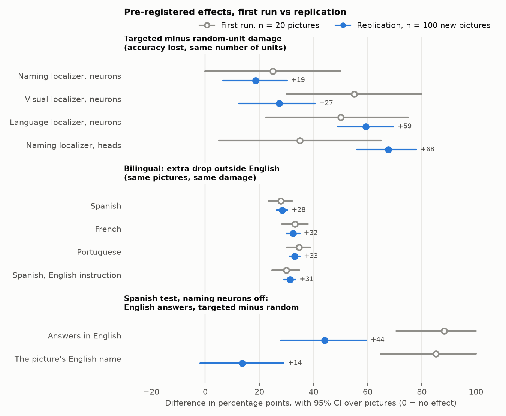
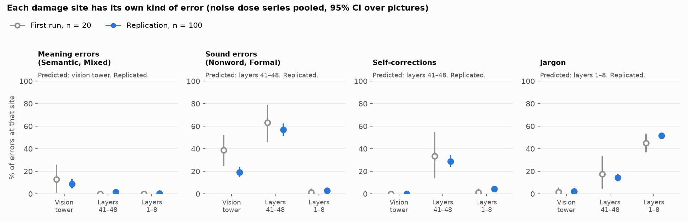

# Replication at n = 100

The plan, conditions and criteria were fixed in advance in [`replication_plan.md`](replication_plan.md).
It was committed (8a26e34) before any lesion ran on the new pictures, and the accepted names were
frozen (8cce675) before the first lesioned run.

**Old and new were analysed with the same code and the same coder.** The first run's data
(n = 20) were re-coded with the current naming coder, which counts English compounds such as
"kiwifruit" as real words. Every primary measure has a 95% bootstrap CI over pictures.

## Verdict

**Every pre-registered criterion is met.** The sizes did not all hold, though: some effects
shrank and one grew.

- **The bilingual result is the solid one.**
  - Damage costs Spanish, French and Portuguese about 30 points more than English, on 100 new
    pictures. The size is the same as at n = 20, and the CIs are a third as wide.
  - Every one of the 96–100 testable pictures fared worse in the other language.
- **Targeted damage hurts more than random damage, for all four localizers.** But:
  - two of the effects are about half the n = 20 size (naming and visual localizers), and one is
    twice it (naming heads);
  - what the targeted lesions break is mostly **instruction following and answer format**, not
    seeing or language. The "visual" lesion makes the model repeat its instruction. That was
    already true at n = 20, and the n = 100 data make it plain.
- **Falling back to English replicates.**
  - **Bilingual test:** about 7–11% of damaged non-English trials give the picture's English name,
    and 0.16% go the other way.
  - **Spanish Model Lab test:** the targeted-vs-random contrast holds, but at half the n = 20 size.
- **Each damage site keeps its own error type.**
  - Late layers 41–48: sound errors and self-corrections.
  - Early layers 1–8: jargon.
  - Vision tower: the most meaning errors of the three sites, though meaning errors are only 9% of
    its errors.
- **The English pivot in the word lens replicates, more weakly.** The English name leads before the
  target on 84–86% of testable pictures, against 93–100% at n = 20.



`docs/figures/replication/effects.png`: every pre-registered difference, with 95% CIs over
pictures. Hollow gray: the first run (n = 20). Blue: the replication (n = 100 new pictures).

## Results, old next to new

"Inside the old CI?" asks whether the n = 100 estimate falls inside the n = 20 interval: did the
size hold, not just the sign?

### 1. Targeted vs random-unit damage (English Model Lab)

- **Measure:** accuracy under the 5 random-unit controls minus accuracy under the targeted lesion,
  paired by picture.
- **Pictures:** those correct intact, which here is all of them (20 and 100).
- **Controls:** the n = 20 run had 2 random controls; the replication has 5.

| Localizer, units, fraction | n = 20: targeted vs random | Δ [95% CI] | n = 100 (new localizer): targeted vs random | Δ [95% CI] | Replicated? | Inside the old CI? | n = 100, original localizer: Δ [95% CI] |
|---|---|---|---|---|---|---|---|
| Naming, MLP, 0.2973 | 0.55 vs 0.80 | +0.25 [+0.00, +0.50] | 0.66 vs 0.85 | **+0.19 [+0.07, +0.30]** | yes | yes | +0.21 [+0.12, +0.30] |
| Visual, MLP, 0.2548 | 0.40 vs 0.95 | +0.55 [+0.30, +0.80] | 0.62 vs 0.89 | **+0.27 [+0.12, +0.41]** | yes | no, smaller | +0.29 [+0.19, +0.38] |
| Language, MLP, 0.3173 | 0.45 vs 0.95 | +0.50 [+0.22, +0.75] | 0.32 vs 0.91 | **+0.59 [+0.49, +0.70]** | yes | yes | +0.37 [+0.07, +0.59] |
| Naming, heads, 0.4042 | 0.55 vs 0.90 | +0.35 [+0.05, +0.65] | 0.23 vs 0.91 | **+0.68 [+0.56, +0.78]** | yes | no, larger | +0.26 [+0.13, +0.38] |

**At n = 20 the naming-localizer contrast was not reliable.** Its CI touched zero. At n = 100 it is
reliable, but smaller: 19 points, not the "55% vs 75–85%" quoted before.

**What the targeted lesions break.** These are the n = 100 answers under each new-localizer lesion:

| Lesion | Typical wrong answer | What it is |
|---|---|---|
| Naming, MLP | "The object in the picture is "  "  "", "…is a " gira" or "" (all 34 errors begin with this frame) | The sentence frame survives and the word is missing or cut off, an anomia-like failure. |
| Visual, MLP | "Name the object in this picture with exactly one word." (33 of 38, plus 4 paraphrases) | The instruction is echoed back. It is not a seeing error. |
| Language, MLP | "", '["self", "user"]', "=self" (54 of 68) | The chat format breaks down. |
| Naming, heads | "The user asks to name the object. The image is a…" (59 of 77) | The model narrates the task in its reasoning voice. |

So the contrast "targeted > random" replicates, but the names "visual" and "language" overstate
what these units do.
- **The visual lesion** leaves the model unable to start an answer, so it echoes the prompt. The
  n = 20 run showed the same thing (12 of 12 errors were echoes) under the label "Seeing units
  switched off".
- **Only the naming-MLP lesion** produces something like a word-finding failure.

### 2. Bilingual: the extra drop outside English

- **Measure:** (intact − lesioned accuracy in the language) − (intact − lesioned accuracy in
  English).
  - Same pictures, pictures correct intact in both languages.
  - Averaged over the 41 conditions and their seeds.
- **p:** a sign-flip test over pictures.

| Language | n = 20: extra drop [95% CI] | n = 100: extra drop [95% CI] | Pictures worse / better in the language (n = 100) | Replicated? | Inside the old CI? |
|---|---|---|---|---|---|
| Spanish | +0.28 [+0.23, +0.32] | **+0.28 [+0.26, +0.30]** | 96 / 0 of 96 | yes, p < 0.0001 | yes |
| French | +0.33 [+0.28, +0.38] | **+0.32 [+0.30, +0.35]** | 100 / 0 of 100 | yes, p < 0.0001 | yes |
| Portuguese | +0.35 [+0.30, +0.39] | **+0.33 [+0.31, +0.35]** | 97 / 0 of 97 | yes, p < 0.0001 | yes |
| Spanish, English instruction | +0.30 [+0.25, +0.35] | **+0.31 [+0.29, +0.33]** | 97 / 0 of 97 | yes, p < 0.0001 | yes |

- **Condition by condition** (Spanish): worse than English in 39 of 41 conditions, tied in 1 and
  better in 1. The better one was noise on layers 0–7 at ×1, with a CI that includes zero. In 33
  conditions the CI excludes zero, and all 33 are Spanish worse.
- **French:** 40 worse, 0 better. **Portuguese:** 40 worse, 1 better (the same ×1 band).
- Details are in [`bilingual.md`](bilingual.md), now updated to n = 100.

### 3. Falling back to English

**(a) Bilingual test.**
- **Measures:** the share of damaged trials whose first attempt is in English, and the stricter
  share that is the picture's English name.
- **The reverse:** the picture's name in another language on English trials.

| | n = 20: English answers | n = 20: English name | n = 100: English answers | n = 100: English name | Replicated? |
|---|---|---|---|---|---|
| Spanish | 23.8% [20.6, 27.6] | 11.0% [8.4, 14.2] | 23.6% [22.5, 24.8] | **10.7% [9.6, 11.9]** | yes |
| French | 17.8% [15.1, 20.7] | 7.6% [5.1, 10.4] | 17.9% [16.8, 19.1] | **8.2% [7.1, 9.3]** | yes |
| Portuguese | 22.2% [20.1, 24.5] | 9.0% [6.9, 11.3] | 20.4% [19.5, 21.5] | **7.2% [6.3, 8.1]** | yes |
| Spanish, English instruction | 36.1% [32.7, 40.4] | 23.9% [21.0, 27.0] | 36.3% [35.0, 37.6] | 22.2% [20.9, 23.5] | not a criterion |
| **Reverse**, English trials | | 0.1% [0.0, 0.4] (1 of 1,780) | | **0.16% [0.03, 0.39]** (14 of 8,900) | |

The 14 reverse trials include near-misses of the English word that the rule-based detector files
under another language: "giraf…", "Girafe? Actually English is "Giraffe"", "artichoe". So 0.16% is
an upper bound.

**(b) Spanish Model Lab test** (`core100_es`, the Model Lab's Spanish prompt, naming-localizer MLP
lesion at 0.2973):

| | n = 20 (original localizer) | n = 100, new localizer | n = 100, original localizer |
|---|---|---|---|
| Accuracy, targeted vs random | 0.05 vs 0.55 | 0.15 vs 0.43 | 0.09 vs 0.56 |
| English answers, targeted vs random | 94% vs 6% | 68% vs 24% | 91% vs 12% |
| Δ English answers [95% CI] | +0.88 [+0.71, +1.00] | **+0.44 [+0.28, +0.60]**, replicated | +0.78 [+0.70, +0.86] |
| Δ the picture's English name [95% CI] | +0.85 [+0.65, +1.00] | +0.14 [−0.02, +0.29], not reliable | +0.58 [+0.47, +0.69] |

The primary measure replicates, at half the size with the new localizer.
- **Why the contrast shrank.** That localizer's *random* controls already wreck Spanish naming:
  accuracy 0.28–0.48, against 0.85 in English. They often answer with the plain English name
  ("Giraffe", "Owl").
- **The original localizer** reproduces the n = 20 picture almost exactly. Typical answers are "The
  object is a cat." and "The object is a horse."

### 4. Error types per damage site

- **Pooling:** each site's errors are pooled over its noise dose series (n = 100: 5 seeds per
  dose; n = 20: 1).
- **Shares** are among error trials. The criterion is the predicted site being largest, with every
  pairwise CI excluding zero.

| Error type (predicted site) | n = 20: vision / L41–48 / L1–8 | n = 100: vision / L41–48 / L1–8 | Replicated? |
|---|---|---|---|
| Meaning: Semantic, Mixed (vision tower) | 12.9 / 0.0 / 0.0% | **8.8** [5.2, 12.8] / 1.6 / 0.2% | yes |
| Sound: Nonword, Formal (layers 41–48) | 38.7 / 63.2 / 1.2% | 19.1 / **57.0** [51.9, 61.9] / 2.7% | yes |
| Self-correction (layers 41–48) | 0.0 / 33.3 / 1.2% | 0.1 / **28.9** [24.3, 33.8] / 4.4% | yes |
| Jargon (layers 1–8) | 1.6 / 17.5 / 45.0% | 2.3 / 14.3 / **51.7** [49.7, 53.8]% | yes |

All four also replicate at the featured doses alone (5 seeds each). At n = 20 the featured doses
alone were too few to pass any criterion but jargon.



**Read the vision result with care.** Meaning errors (teapot for kettle) are rarer at n = 100: 9% of
vision-tower errors.
- **Most vision-tower errors** are unrelated real words: the noisy picture is read as a "map"
  (231 times), a "QR code" (181), a "word search puzzle" (123), a "logo" or a "barcode".
- **These are visual misreadings.** The model reads the noise texture as a graphic. That is
  look-alike only loosely.
- **The fair summary:** vision damage gives the most meaning errors of the three sites, and mostly
  misreadings.

### 5. Secondary: the English pivot in the word lens (intact)

| | n = 20 | n = 100 |
|---|---|---|
| Spanish: English name the top guess before the target | 15 of 15 | **72 of 86 (84%)** |
| French | 14 of 15 | **69 of 81 (85%)** |
| Portuguese | 14 of 15 | **72 of 84 (86%)** |
| Peak share of trials with the English name on top | 87–93%, layers 39–40 | 67–71%, layers 39–40 |
| Target becomes the top guess on most trials from | layer 47 | layer 47 |

- **Verdict:** replicated by the criterion (at least 80% in each language), but weaker than the
  near-universal pattern at n = 20.
- **Not predictive per picture:** a stronger intact pivot still does not reliably predict which
  pictures switch under damage. Spearman's rho is 0.24 for Spanish (p = 0.03 uncorrected, one of
  four tests), and 0.12, 0.06 and 0.14 for the others.

## What changed from n = 20, in one line each

- **Bilingual extra drop:** the same size (+28 to +35 points), with CIs about 2.5 times narrower.
- **Targeted vs random:** the same sign everywhere.
  - Naming MLP 25 → 19 points.
  - Visual 55 → 27.
  - Language 50 → 59.
  - Naming heads 35 → 68.
- **Spanish Model Lab fallback:** 88 → 44 points with the new localizer, 78 with the original.
- **Error types:** the same ranking.
  - Sound errors at the vision tower fell from 39% to 19% of its errors.
  - Meaning errors there fell from 13% to 9%.
- **Lens pivot:** pooled over the three languages, from 43 of 45 testable pictures (96%) to 213 of
  251 (85%).

## Caveats

- **One model, one precision** (Muse Glimmer 30B, decoder FP8), and new pictures from the same
  generator (Muse Image line drawings). A different picture style could change the numbers.
- **The doses and conditions are the first run's, applied unchanged.** That is the point of a
  replication, but it means the conditions are a fixed, hand-chosen set, not a sample of all
  lesions.
- **The new localizers** come from 100 held-out drawings instead of 20. With the same fraction of
  units, that changes which units are hit. The table shows both the new and the original localizer
  on the new pictures.
- **No meaning judge.**
  - English meaning relations come from WordNet.
  - Semantic vs Unrelated would shift with the Muse Spark judge.
  - Accuracy, the switch measures and the sound, self-correction and jargon measures don't depend
    on it.
- **About 15 primary tests, uncorrected.** All passed. The largest p among the bilingual tests is
  below 0.0001.
- **Accepted names** for three pictures (shoe, tooth, moon) were added after the intact pilot and
  before any lesion, in every language. Without them those pictures would simply drop out of the
  intact-correct set.

## Reproduce

The commands are under "Rerun commands" below. Results are in:
- `runs/replication/results.json` (`scripts/replication_analyze.py`);
- `runs/bilingual_core100/results.json`, and `runs/bilingual_n20/results.json` for the first run
  re-coded;
- `runs/lesion/core100_en`, `runs/lesion/core100_es`.

Figures: `scripts/replication_figures.py` and `scripts/bilingual_figures.py`.

## Progress notes

### Oct 27: pictures

- **Word list:** `scripts/wordlists/core100.json`, 100 words, including the 20 demo words.
- **English set** `core100_en`:
  - Built by Test Studio: 2 drawings per word, SAM 3.1 and Muse Spark checks.
  - The automatic checks kept 93 of 100.
  - In review were lemon, watermelon, comb, ear and nose: SAM found no object box, though the
    drawings are clear.
  - Kettle was also in review: both drawings are teapots, as in the first run.
  - Whistle was in review because neither drawing reads as a whistle.
- **Visual review** (`scripts/replication/core100_review.json`, applied by
  `scripts/review_set.py`). Every picture was checked by eye on the contact sheet, before any GPU
  run.
  - **Kept by eye:** lemon, watermelon, comb, ear and nose. SAM missed them; each drawing is one
    clear object, and Muse Spark named it correctly.
  - **Kettle kept:** teapot is an accepted name in every language, as in the first run.
  - **Flute:** switched to the drawing with keys. The automatic pick reads as a recorder.
  - **Redrawn:** whistle (one drawing read as a fishing lure, the other as a tube) and tie (both read
    as a ribbon or scarf). Redraw set `core100_fix`.
  - **Dropped: none.** All **100 pictures kept**.
- **Spanish, French and Portuguese sets:** the same 100 pictures, named from the word table
  (`scripts/language_sets.py`).
  - Muse Spark named them in each language and agreed with the table on 99 (Spanish), 98 (French)
    and 99 (Portuguese).
  - The disagreements were *caracol* for the spiral shell, and two more specific names for the
    drawn object: *bottine* (ankle boot) and *tênis* (sneaker).
- **Cost:**
  - English set: $3.19.
  - Redraws: $0.09.
  - Muse Spark name check: $0.25.
  - **Total: $3.53** of Meta API credit.

### Oct 27: intact naming, reference statistics, localizers

These ran on axon-server02 and axon-server01. None of them are lesions.

- **Intact Model Lab:**
  - English (`core100_en`): 99 of 100. Moon → "Crescent".
  - Spanish (`core100_es`, Spanish prompt): 95 of 100. Misses: *diente* → "Molar", *concha* →
    "caracol", *tambor* → "Batería", *zapato* → "zapatilla", *iglú* → "Igloo".
- **Intact bilingual pilot** (matched prompts, as coded on the GPU box):
  - English: 100. Spanish: 95. French: 99. Portuguese: 96. Spanish with the English instruction: 96.
- **Accepted names frozen** after these intact runs, **before any lesion run**.
  - Three additions, each made in every language, on one principle: the name of the drawn subtype.
    - **Shoe:** the drawing is a sneaker. Added sneaker and trainer; *zapatilla* and *tenis*;
      *basket* and *tennis*; *tênis*.
    - **Tooth:** the drawing is a molar. Added molar, *molar*, *molaire* and *molar*.
    - **Moon:** the drawing is a crescent. Added crescent, *creciente*, *croissant* and *crescente*.
  - **Not accepted:**
    - *caracol* for the shell (it is the snail item's name);
    - *Batería* or *bombo* for the snare drum (other drums);
    - "Boleado" (not a word).
  - As in the first run, the bilingual test drops an alternate spelled like an English name.
    Spanish and Portuguese *molar* therefore count as English-identical there, and the tooth stays
    an intact miss in the bilingual Spanish test. The Model Lab's Spanish test accepts *molar*.
  - **Intact after the freeze:**
    - Model Lab: English 100, Spanish 97.
    - Bilingual: English 100, Spanish 96, French 100, Portuguese 97, Spanish with the English
      instruction 97.
- **Reference statistics:**
  - Model Lab: from the 100 held-out drawings (`unit_stats_core100_en.pt`, `unit_stats_core100_es.pt`).
  - Bilingual test: pooled over the 4 prompts (400 trials), plus English-only and Spanish-only.
- **Localizers:** `naming_c100`, `visual_c100` and `language_c100`. The naming and visual ones come
  from the 100 held-out drawings; the language one is from 40 sentences.

### Oct 27: lesion runs (all finished, none failed)

| Server (one L40S each) | Ran | Clock (UTC) | GPU time |
|---|---|---|---|
| axon-server02 | intact, statistics, localizers; Model Lab: 48 featured + 12 Spanish + 107 component conditions | 04:55–05:06, 05:15–06:57 | 113 min |
| axon-server01 | intact, bilingual statistics and pilot; bilingual part A: intact and bands 0–39 (230 runs) | 05:03–05:10, 05:15–07:34 | 147 min |
| axon-server03 | bilingual part B: bands 40–51, vision tower, unit lesions, pruning, robustness (260 runs) | 05:16–07:53 | 156 min |

- **Total:** about 6.9 GPU-hours. All 490 planned bilingual runs and all 167 Model Lab conditions
  finished.
- **Shared inputs:** every server used the same bilingual reference statistics, computed on
  axon-server01 and copied to the others, and the same `naming_en` localizer file.
- **Results** are copied to `runs/` here and in the main checkout:
  - `runs/lesion/core100_en`, `runs/lesion/core100_es`;
  - `runs/bilingual_core100/raw`;
  - the server logs, in `runs/replication/logs/`.

### Oct 27: analysis

- **Merge:** main was merged in first (its new naming coder).
- **Re-coding:** both runs were re-coded with that coder, and the Model Lab result files were
  re-coded in place with the frozen names.
- **Analyses:** `bilingual_analyze.py` for both runs, then `replication_analyze.py`, all with 10,000
  resamples.
- **Figures:** `docs/figures/replication/` and `docs/figures/bilingual/`. The first run's
  bilingual figures moved to `docs/figures/bilingual/n20/`.
- **Results** are copied to the main checkout's `runs/`: `bilingual_core100`, `bilingual_n20`,
  `replication`, `lesion/core100_*` and `sets/core100_*`.
- **Web export:** `scripts/bilingual_web_export.py --dir runs/bilingual_core100` was run in the
  main checkout. It wrote `metalesionlab/web/data/bilingual.json` there, uncommitted, for main.

### Rerun commands

If a step is interrupted, run it again with the same command: Model Lab batches skip finished
conditions (`--skip-done`), and `bilingual_run.py run` skips finished raw files.

```bash
# On an Axon server, from ~/MetaLesionLab (env: ~/mll-env; PYTHONPATH=$PWD plus the server's
# NLTK/WordNet path: ~/mll-lesion-deps on 01 and 03, NLTK_DATA=~/mll-compress-nltk on 02).
# Inputs: runs/sets/core100_{en,es,fr,pt}, runs/localizers/{naming,visual,language}_{en,c100}.pt,
# runs/cache/unit_stats_core100_{en,es}.pt, runs/bilingual_core100/cache/unit_stats_{pooled,en,es}.pt
python scripts/model_lab.py batch runs/sets/core100_en scripts/replication/featured_en.json --skip-done
python scripts/model_lab.py batch runs/sets/core100_es scripts/replication/featured_es.json --skip-done
python scripts/model_lab.py batch runs/sets/core100_en scripts/replication/components_en.json --skip-done
python scripts/bilingual_run.py ids --prefix core100 --out runs/bilingual_core100
python scripts/bilingual_run.py run --prefix core100 --out runs/bilingual_core100 \
    --only '^(intact|layers.(0-7|8-15|16-23|24-31|32-39))$'                        # part A, 230 runs
python scripts/bilingual_run.py run --prefix core100 --out runs/bilingual_core100 \
    --only '^(layers.(40-47|48-51)|vision_tower|naming_en|random|pruned|robustness)'  # part B, 260 runs

# On the Mac, after copying runs/ back (MAIN = the main checkout; both n = 20 and n = 100 are
# re-coded with the current coder):
mkdir -p runs/bilingual_n20 && cp -R $MAIN/runs/bilingual/{raw,plan.json,name_ids.json} runs/bilingual_n20/
python scripts/bilingual_analyze.py --prefix demo --sets $MAIN/runs/sets --dir runs/bilingual_n20 --boot 10000
python scripts/bilingual_analyze.py --prefix core100 --dir runs/bilingual_core100 --boot 10000
python scripts/bilingual_figures.py --dir runs/bilingual_core100
python scripts/replication_analyze.py --old-runs $MAIN/runs --old-bilingual runs/bilingual_n20 --boot 10000
python scripts/replication_figures.py
```
